# Rig Builder

[← Contents](index.md)

For a narrated demonstration of both rig types, see the [IK/FK beginner walkthrough and practice file](https://github.com/Axleonex/B4Artists_Toolkit/blob/main/bonecraft/docs/tutorials/ikfk-beginner.md).

## Building a New Rig

The Rig Builder makes a new rig for a character. It is in its own **Rig Builder** tab on the left Tool Shelf (press **T**), and in the **Properties** editor's **Scene** tab while Preferences → Tabs → Scene Properties → Show is on. In a narrow Tool Shelf it switches to a compact layout with short labels. The Auto-Rig Wizard comes first, followed by Quick Rig and Mannequin. You can also start the wizard or add a Quick Rig from the viewport's Add → Armature menu.

---

### Auto-Rig Wizard

**What it does:** A step-by-step guide that places markers on your mesh and builds a complete rig with weights from them. The main way to rig a character from scratch.

[Guide 1](02-guides-a.md#guide-1-get-your-first-avatar-into-vrchat) walks through it step by step.

**Steps:** Select Mesh → Rig Type → Body Markers → Finger Markers → Face Markers → Review → Generate

**Key controls:**
- **Start Auto-Rig** opens the wizard. **Back** and **Cancel** are at the top; **Next** is at the bottom of the mesh, rig-type and marker steps. Review uses **Generate Rig** instead of Next; the final step uses **Close Wizard**
- The mesh list (click your mesh), then the rig type: **Body + Face**, **Body Only** or **Face Only** (for an existing armature)
- **Detect Markers** (in Smart Detection) — traces the limbs in the mesh and places every body marker with a confidence; **Accept High** keeps the sure ones and **Reset Low** clears the doubtful ones
- **Guess Markers from Mesh** and **Guess Precision** (body), **Guess Finger Markers** (finger markers are placed from the shape of the hand) and **Guess Face Markers**
- Finger Detail — how many fingers to build, from "0 — No Fingers" to "5 — Full Human Hand"
- Each marker's row: **Place Marker** (arrow icon), **Confirm Marker** (check mark) and **Reset Marker** (circular arrow); **Toggle Symmetry** (first icon) on left and right markers
- **Mirror L to R** and **Mirror R to L** — copy confirmed markers across the centre line
- **Confirm All Placed** — confirms every placed marker of the step
- **Generate Rig** — builds the rig from the confirmed markers; then, on the last step, **Build Control Rig** (see below) and **Close Wizard**

**What Generate Rig builds:**
- A body rig with the spine and neck segments you chose, and IK/FK, IK-only or FK-only arms and legs (the **Kinematics** option)
- Finger bones for the finger count you chose
- For **Body + Face**: a face rig, with control shapes when **Generate Control Shapes** is on
- Skin weights at the chosen quality. Dense meshes are weighted through a lighter proxy mesh, so a 678,000-vertex character takes about a minute instead of failing silently.

**Build Control Rig:** the review step also shows **Twist Bones**, **Skirt Bones**, **Face Controls** and **Joint Correctives**. Generate Rig does not apply them. They belong to the engine control rig (twist bones, skirt bones that follow the legs, eye aim and blink controls, and joint corrective shape keys). After Generate Rig, the last step offers **Build Control Rig**, which builds that rig on the generated armature with the options you chose. Click it before **Close Wizard**, because closing resets the wizard's options. The Control Layer panel (Rig Tools) appears only on a rig built this way.

**Where to find it:** Rig Builder → Auto-Rig Wizard

**Place several markers with the viewport tool:** start the wizard and advance to a body, finger or face marker step. In Object Mode, activate Place Rig Markers in the viewport toolbar. The tool header names the next unconfirmed marker and shows axis locks and a mirror switch. Click the wizard's mesh to place and confirm that marker. Symmetry follows the wizard's settings; the per-marker Place buttons still work. When the tool says the step is done, press **Next** in the wizard. Clicking elsewhere does not place a marker.

---

### Quick Rig

**What it does:** Adds a ready-made armature in one click: BoneCraft's Basic Humanoid (19 bones, no Rigify needed) or one of Rigify's metarigs. Faster than the wizard, less tailored.

**Key controls:**
- The Basic Humanoid button, and the Rigify metarigs (**Enable Rigify** first, if Rigify is off)
- Click a rig button to add it immediately, then adjust fitting to the mesh, automatic weights, **Add IK/FK Controllers** and **Initial Pose** in Adjust Last Operation
- **T-Pose** and **A-Pose** — switch the selected rig's rest pose
- Expand Troubleshooting for **Diagnose Quick Rig (print to console)**. With a non-metarig armature active it also shows **Inspect Active Rig Controls**
- With a Rigify metarig active, Troubleshooting shows **Generate Control Rig (active metarig)** instead of Inspect Active Rig Controls; it generates the Rigify control rig

**The BoneCraft Rigs starter catalog:** the viewport asset shelf starts with all nine bundled starters visible, grouped into Humans, Quadrupeds and Other Animals. **Starter Rigs** in the viewport header switches between this collection and the regular Bforartists asset shelf. The adjacent catalog button, or **Add → Armature → Starter Rig Catalog**, opens the same collection as a popup. Your shelf choice is stored in BoneCraft's preferences.

Basic Humanoid needs no Rigify. The other thumbnails are labelled **Rigify**. If Rigify is inactive, choosing or dropping one offers **Enable Rigify & Add Rig** and Cancel. Accepting enables the installed Rigify and continues with that starter; cancelling adds nothing. The viewport header also has a single **Enable Rigify** button. A missing dependency or a preset absent from your installed version produces an explanation without adding a substitute rig.

Click a thumbnail to add a starter, or drag it into the viewport. With a mesh selected, the starter is fitted to that mesh; automatic weighting and control generation start off. Adjust them afterwards in **Adjust Last Operation**. With no mesh selected, select the new starter and pick the **Mesh** in Quick Rig, then click **Fit Dropped Rig**. Fitting scales and positions the skeleton; inspect and edit joint placement before generating controls or weighting. Dragging outside the viewport, pressing Esc, or right-clicking cancels without adding anything.

**Where to find it:** Rig Builder → Quick Rig; Add → Armature → Quick Rig also adds the premade rigs

---

### Mannequin

**What it does:** Builds a preview mesh around an existing rig so you can inspect its deformation without a finished character mesh. Select the armature, or a mesh parented to it, first. If you have no rig yet, add one with Quick Rig. The mannequin is a preview only: replace it with your own mesh before final use.

**Key controls:**
- **Quick Mannequin** — builds a preview with fixed defaults, replacing the previous mannequin for this rig
- **Add Mannequin** — builds a preview using the scene settings; it replaces an existing mannequin by default. Replace Existing is in Adjust Last Operation after the click
- **Regenerate** — rebuilds the existing preview using its saved settings
- **Remove** — deletes the mannequin mesh and keeps the armature
- Expand Options below the buttons for **Mode**, **Body Type**, density and **Radius Scale**; Advanced inside Options holds the region scales and output settings. To use changed scene settings, click **Add Mannequin** again

**Where to find it:** Rig Builder → Mannequin

---

## Illustrated mannequin workshop

<!-- Keep each illustrated step together and preserve the manual's print scale. -->
<style>
section.chapter:has(#ch-06-rig-builder) img { max-width: 100%; max-height: 155mm; width: auto; height: auto; }
@media print {
  [id="06-rig-builder--illustrated-mannequin-workshop"] { break-before: page; break-after: avoid; }
  h4[id^="06-rig-builder--"] { break-before: page; break-after: avoid; }
  h3[id^="06-rig-builder--part-"] { break-before: page; break-after: avoid; }
  h3[id^="06-rig-builder--part-"] + h4 { break-before: avoid; }
  section.chapter:has(#ch-06-rig-builder) h4 + p { break-after: avoid; }
  section.chapter:has(#ch-06-rig-builder) p:has(> img) { break-before: avoid; break-after: avoid; }
  section.chapter:has(#ch-06-rig-builder) p:has(> img) + p { break-before: avoid; }
}
</style>

Follow these three parts in order: [A — Simple Human to mannequin](#part-a-simple-human-to-mannequin), [B — rigless mannequin through Auto-Rig](#part-b-rigless-mannequin-through-auto-rig), and [C — test weights and use IK/FK](#part-c-test-weights-and-use-ikfk). Every numbered step has a real interface screenshot; red numbers match the caption. Screenshots were captured with the **BoneCraft 9.1.2 release** in `Bforartists 5.2.0`. Blender’s panel arrangement and shortcuts can differ; the named commands are the reference.

This exercise produces a simple capsule preview for learning rigging. Its head, hands and torso are placeholders, and it is not a finished character model. Begin in a new file; keep the two saved checkpoints so you can repeat the conversion without losing the original metarig.

The repository includes both checkpoints in `examples/mannequin/`: `SimpleHuman_Mannequin.blend` is the neutral Part A result, and `Mannequin_AutoRig.blend` is the completed, posed Part C example with corrected weights.

### Part A: Simple Human to mannequin

#### A1. Enable Rigify

Start in a new scene. Open **Scene Properties → Rig Builder → Quick Rig**. If the Rigify presets are unavailable, click **Enable Rigify**. This tutorial uses the Rigify `Simple Human` metarig; **BoneCraft Basic Humanoid (19 bones)** is a different preset.

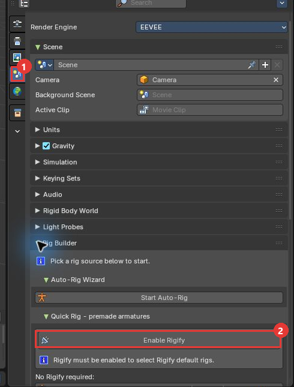

*1 — Scene Properties. 2 — Enable Rigify.*

#### A2. Add Simple Human

Click `Simple Human` under Quick Rig. The result is an editable metarig, not yet a mesh. It has 29 bones in this release.

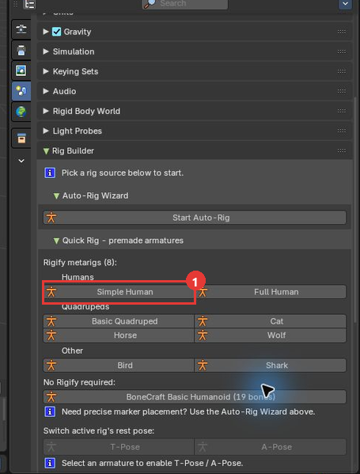

*1 — Simple Human preset.*

#### A3. Inspect the metarig

Move the pointer into the viewport and press `Numpad 1` for Front Orthographic. Check that the whole skeleton is visible. Use the mouse wheel to frame it. The new metarig may start in Pose Mode.

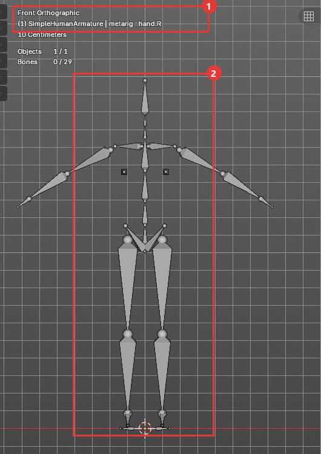

*1 — Front view. 2 — Simple Human skeleton.*

#### A4. Return to Object Mode

Use the viewport mode dropdown and choose **Object Mode**. Keep `SimpleHumanArmature` selected. Choose Object Mode before changing the rest pose or generating the mannequin.

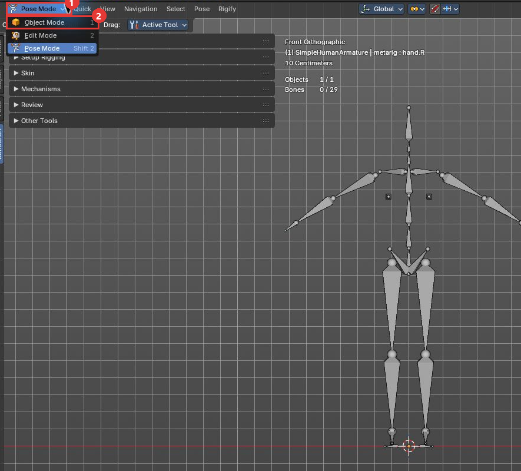

*1 — Mode dropdown. 2 — Object Mode.*

#### A5. Use a T-pose

In Quick Rig, click **T-Pose**. The arms extend horizontally. For a custom body, fit the metarig in Edit Mode before generating its preview; keep left and right joints symmetric for this exercise.

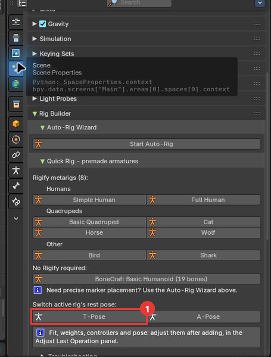

*1 — T-Pose command.*

#### A6. Generate the mannequin

Expand **Mannequin → Options**. Set `Mode: Universal`, `Body Type: Neutral`, **Medium**, and `Radius Scale: 1.00`. Under Advanced, keep region scales at 1.00, choose `Joined (non-manifold)`, **Flat colour**, and enable **Joint Smoothing**. Leave Unified Volume off. Click **Add Mannequin** after setting these options. The screenshot shows the resulting capsule mesh. Use Add for current options; Regenerate reuses the saved mannequin settings.

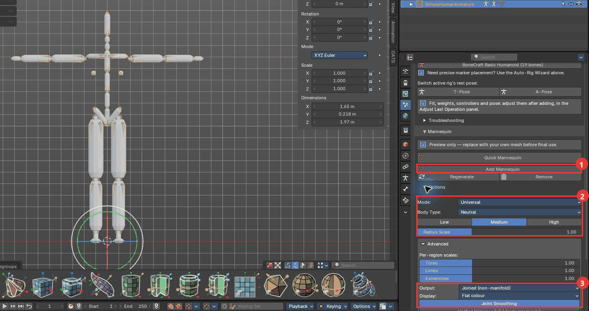

*1 — Add Mannequin. 2 — Universal and body settings. 3 — Joined output and smoothing.*

#### A7. Try a bone pose

Select the armature, switch to **Pose Mode**, and click the left forearm bone (the character’s left is on your right in front view). Rotate it slightly with the Rotate tool; the attached mannequin follows. This is a weighted preview on the metarig. It does not yet have the animator controls used in Part C.

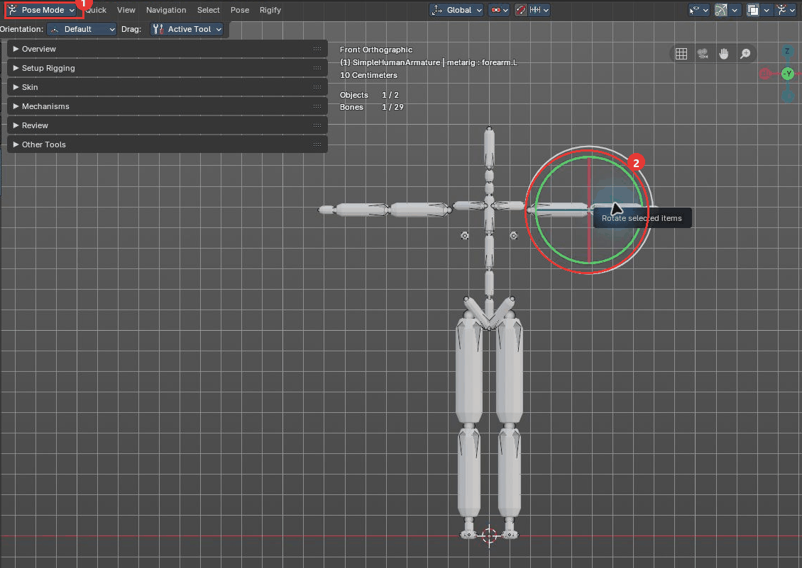

*1 — Pose Mode. 2 — Selected forearm and its transform gizmo.*

#### A8. Restore and save the preview

With the pointer in the viewport, select all pose bones. Press **F3**, search `Clear Pose Transforms`, and choose **All**. Confirm the mannequin returns to its T-pose. Use **File → Save As** and name the file `SimpleHuman_Mannequin.blend`. Keep this checkpoint before continuing.

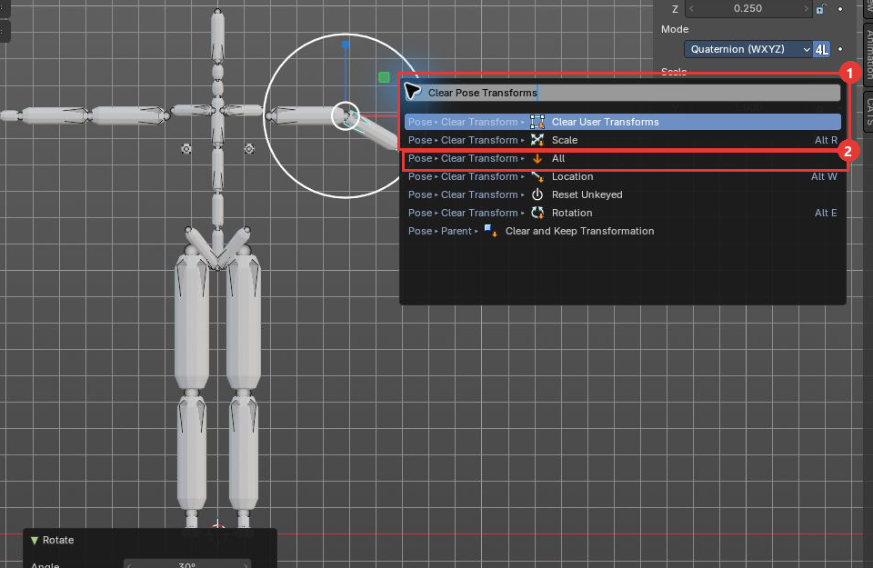

*1 — Clear Pose Transforms search. 2 — All resets the selected pose bones.*

### Part B: Rigless mannequin through Auto-Rig

#### B1. Select the mannequin mesh

Continue from the neutral checkpoint in Part A. Switch to **Object Mode** and select `SimpleHumanArmature_Mannequin` in the Outliner. We will deliberately remove its rig before running the wizard. Save the result under a different filename to preserve Part A.

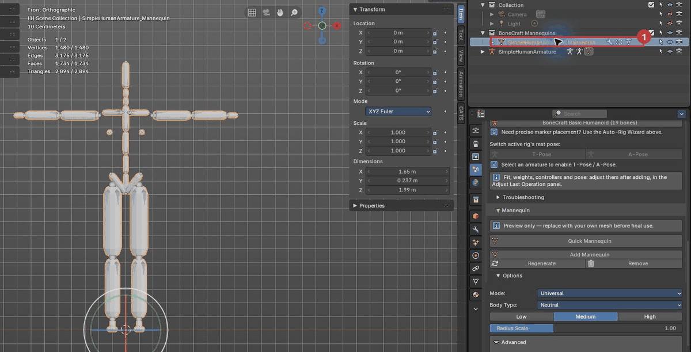

*1 — Select the mesh, not the armature.*

#### B2. Bake the preview into a mesh

With only the mannequin selected, press **F3**, search `Convert Mesh`, and execute it. This keeps the visible neutral geometry and removes the Armature modifier. Do this with the mannequin in its restored T-pose.

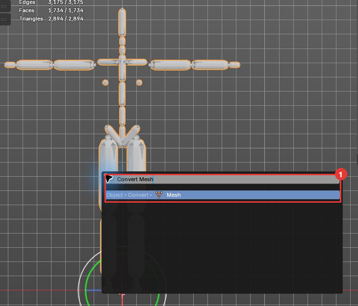

*1 — Convert Mesh command.*

#### B3. Clear the parent

Press **Alt+P** and choose `Clear and Keep Transformation`. This detaches the mesh from the old metarig without moving it.

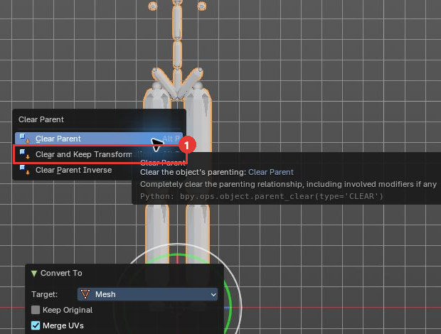

*1 — Clear and Keep Transformation.*

#### B4. Remove the old weights

Open **Object Data Properties → Vertex Groups**. In the list’s dropdown menu choose `Delete All Groups`. These groups belong to the old metarig; the wizard will create new ones. This action is for this disposable training mesh.

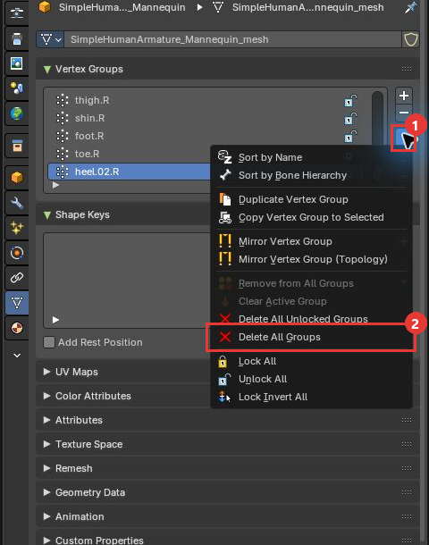

*1 — Vertex Groups menu. 2 — Delete All Groups.*

#### B5. Verify the rigless checkpoint

Hide the old `SimpleHumanArmature` using its Outliner eye icon. Check the mannequin remains visible, its Modifiers panel has no Armature modifier, and its Vertex Groups list is empty. This is the rigless mannequin input. BoneCraft 9.1.2 generates mannequins from an armature; detaching this preview is the route to a rigless training mesh.

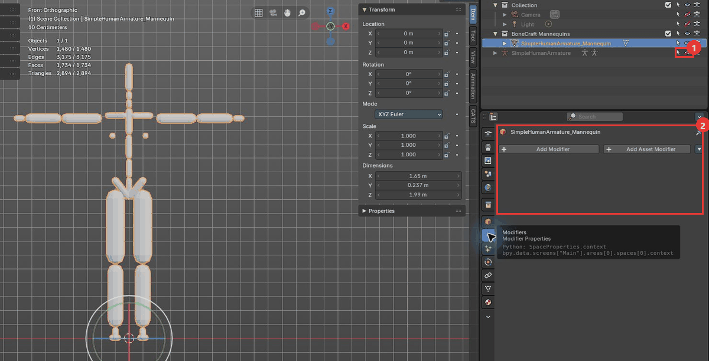

*1 — Hide the old metarig. 2 — Empty modifier stack.*

#### B6. Enable the viewport Rig Builder tab

Open **Edit → Preferences → Add-ons → BoneCraft → Tabs**. Enable **Rig Builder** and choose **Left**. Close Preferences, place the pointer over the viewport, and press **T** if the left Tool Shelf is hidden. Use this viewport tab for marker placement: in the tested 9.1.2 host, starting Place Marker from Scene Properties did not accept viewport clicks.

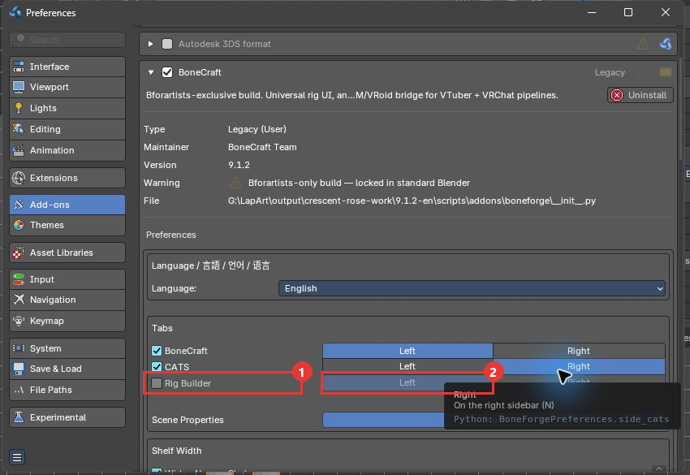

*1 — Enable Rig Builder. 2 — Left Tool Shelf placement.*

#### B7. Start Auto-Rig

With the rigless mannequin selected, click **Start Auto-Rig**. The screenshot shows the equivalent Scene Properties button; the same command is at the top of the viewport Rig Builder tab enabled in the previous step.

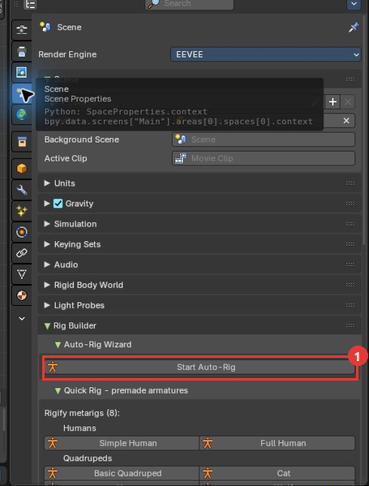

*1 — Start Auto-Rig.*

#### B8. Choose the input mesh

In `Select Mesh`, choose the mannequin and verify the selected-mesh check, then click **Next**. Do not choose a widget or another preview object.

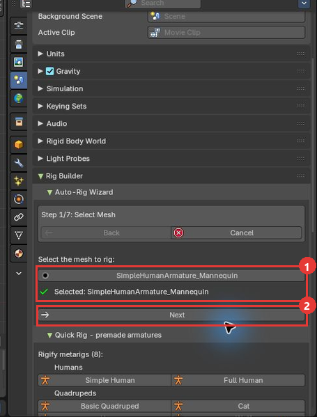

*1 — Mannequin input. 2 — Next.*

#### B9. Choose a body rig with both methods

Select **Body Only** and `Kinematics: IK + FK`. Keep **Generate Control Shapes** enabled. Click **Next**. This capsule mannequin has no facial topology, so Body + Face is unnecessary.

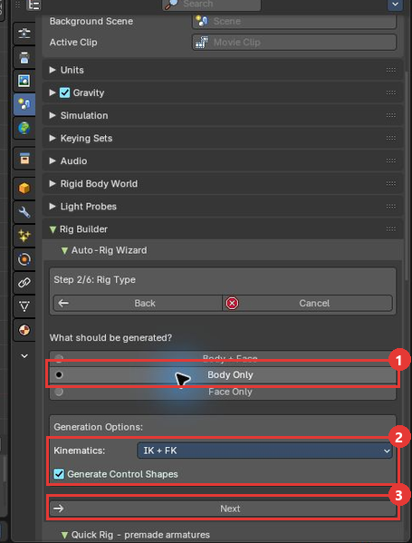

*1 — Body Only. 2 — IK + FK. 3 — Next.*

#### B10. Detect initial body markers

In Body Markers, click **Detect Markers** under Smart Detection. Treat its guesses as a starting point. Keep **Mirror Symmetry** enabled for this symmetric mannequin. Do not accept every guess without checking it.

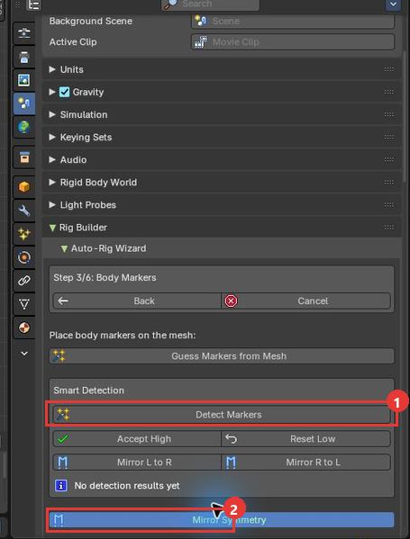

*1 — Detect Markers. 2 — Mirror Symmetry.*

#### B11. Review the detected positions

Check head top, neck base, pelvis, wrists and ankles against the visible mesh. This segmented preview produces several low-confidence guesses. Review and correct both the main landmarks and the optional precision landmarks before generating. The confidence labels describe the original detection; a green check at the start of a row indicates that the current placement is confirmed.

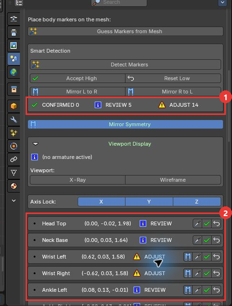

*1 — Detection confidence summary. 2 — Body marker rows.*

#### B12. Place a wrist on the mesh

In the viewport **Rig Builder** tab, click the **Place Marker** eyedropper on Wrist Left, then click the wrist surface in the viewport. For an already confirmed marker, reset that row first to expose its placement button. In front view, the character’s left wrist is on the screen’s right.

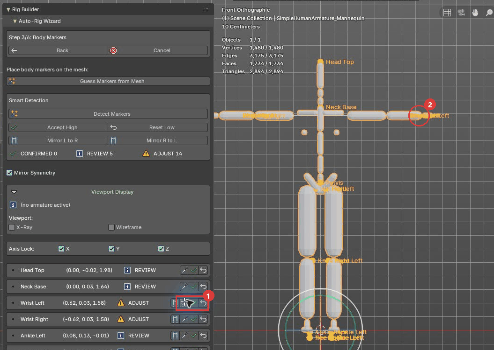

*1 — Wrist Left placement control. 2 — Click the wrist surface.*

#### B13. Check the mirrored wrist and ankles

Verify both wrist rows now show green checks and opposite X coordinates. Repeat placement for `Ankle Left`; symmetry supplies Ankle Right. Place each ankle at its joint, not at the toe. Check symmetry against the mesh rather than copying the example coordinates onto a differently sized character.

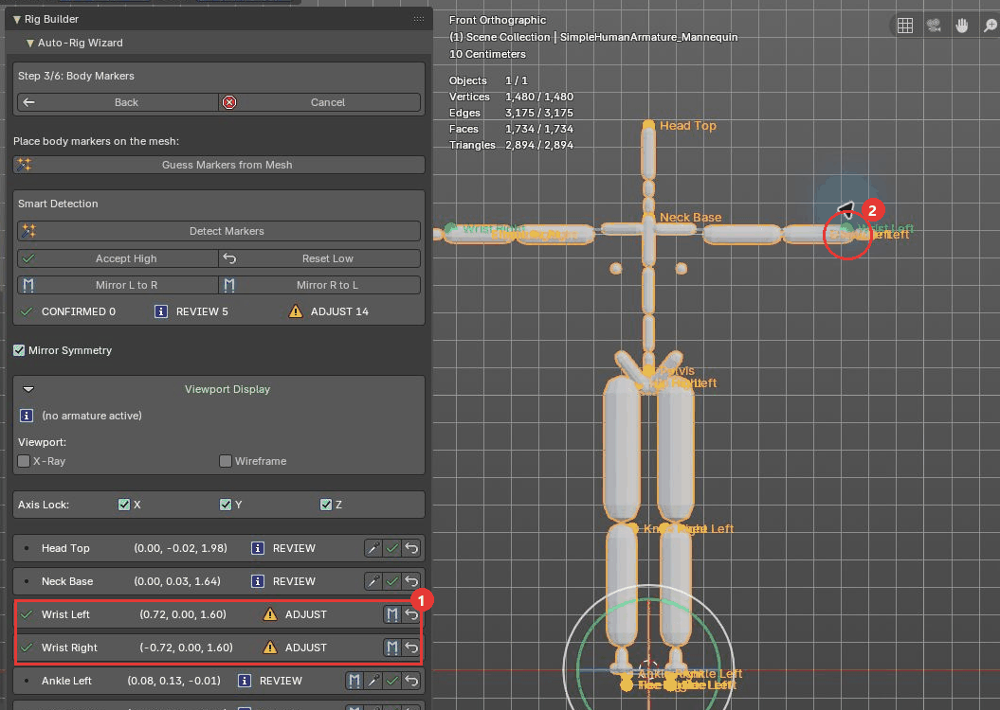

*1 — Confirmed wrist pair. 2 — Mirrored wrist on the mesh.*

#### B14. Refine shoulders and elbows

Scroll to Precision Markers. Reset and place `Shoulder Left` at the upper-arm pivot and `Elbow Left` at the elbow gap. Confirm their mirrored partners. Keep the wrist at the hand end of the forearm. These points determine the arm chain, so a shoulder or elbow guessed on the wrong capsule needs correction.

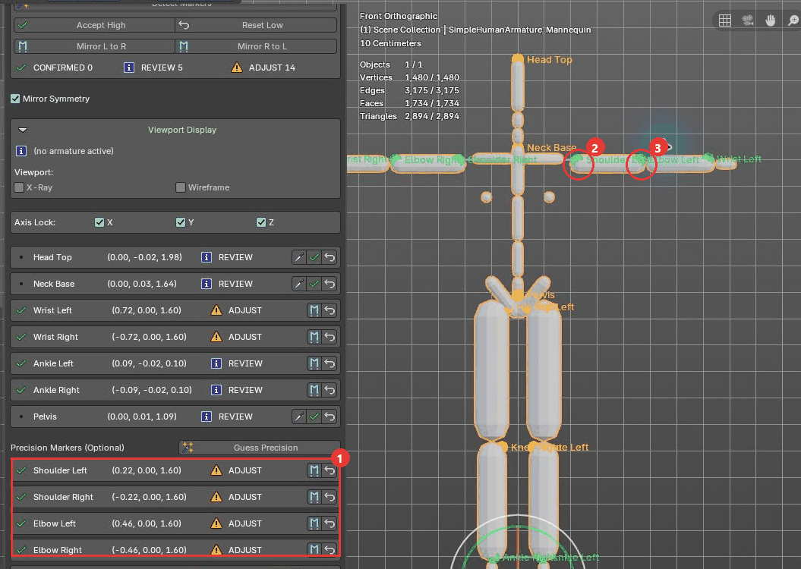

*1 — Shoulder and elbow marker rows. 2 — Shoulder. 3 — Elbow.*

#### B15. Refine hips and knees

Place `Hip Left` at the top of the thigh and `Knee Left` at the thigh/shin gap. Check the opposite side supplied by symmetry. Keep the pelvis on the centre line, between the hips.

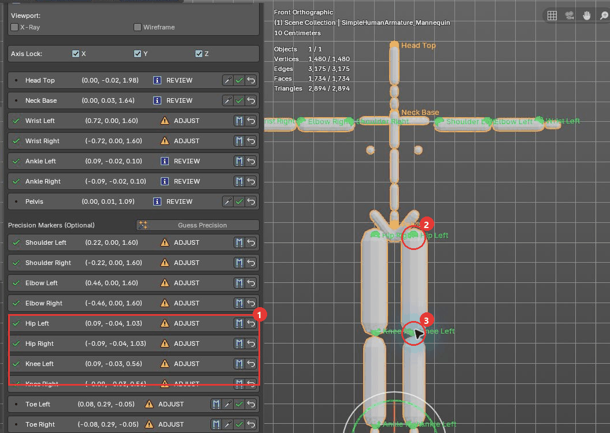

*1 — Hip and knee rows. 2 — Hip surface. 3 — Knee gap.*

#### B16. Check depth and toes from the side

Press `Numpad 3` with the pointer over the viewport. Check the landmarks in Right Orthographic as well as from the front. Place `Toe Left` near the front of the foot; verify its mirrored partner. A marker can appear correct from the front yet be too far forward or behind the body.

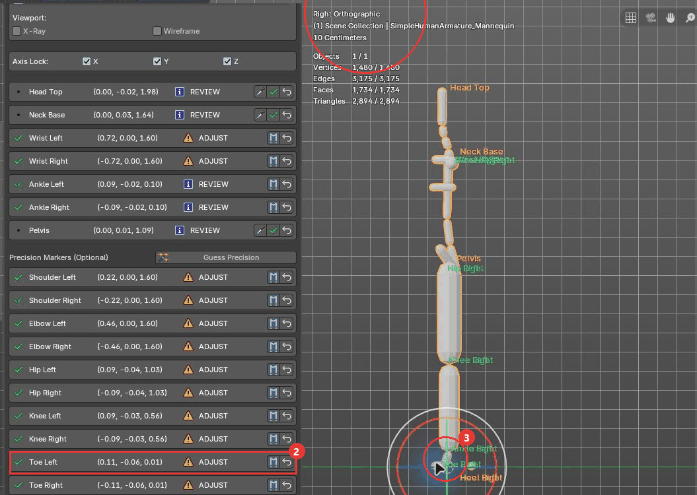

*1 — Right Orthographic. 2 — Toe marker row. 3 — Foot surface.*

#### B17. Place the heels

Reset a wrongly guessed heel, then place `Heel Left` near the back of the foot in side view. Verify Heel Right. Although these markers are optional, leaving both at zero produced a proximity warning in the tested release. Placing them on the feet cleared that warning.

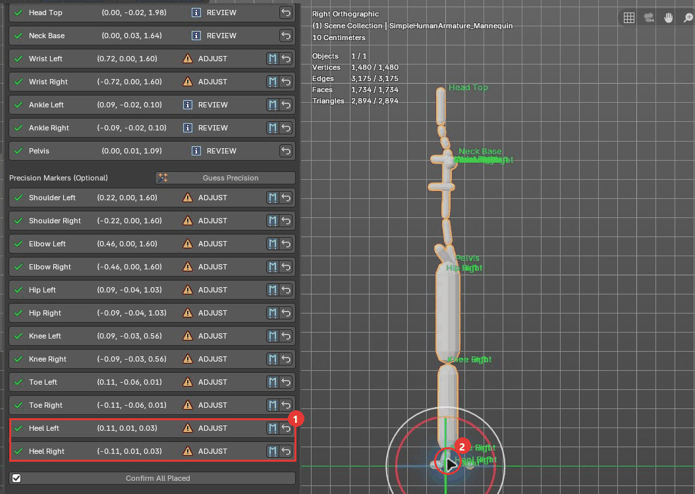

*1 — Confirmed heel pair. 2 — Heel location.*

#### B18. Confirm and continue

Review head top, neck base and pelvis as well as every paired landmark. Click **Confirm All Placed**, then **Next**. The green checks beside the names are the confirmation state; the original REVIEW/ADJUST confidence labels may remain visible in 9.1.2.

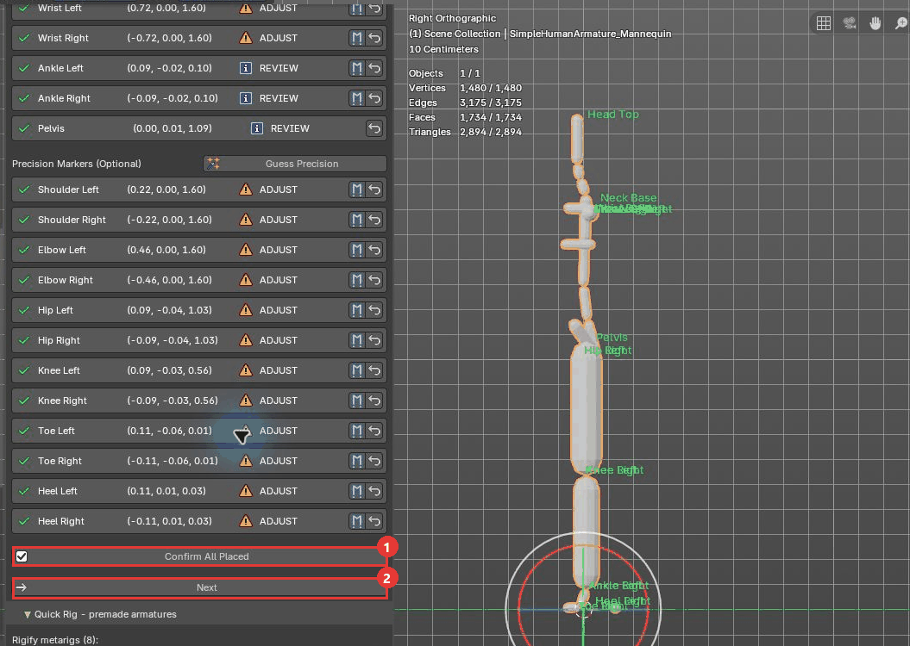

*1 — Confirm All Placed. 2 — Next.*

#### B19. Skip fingers for this mesh

Choose `0 — No Fingers` and click **Next**. This mannequin has hand capsules but no finger geometry. On a real hand mesh, choose the appropriate count and place its finger markers instead.

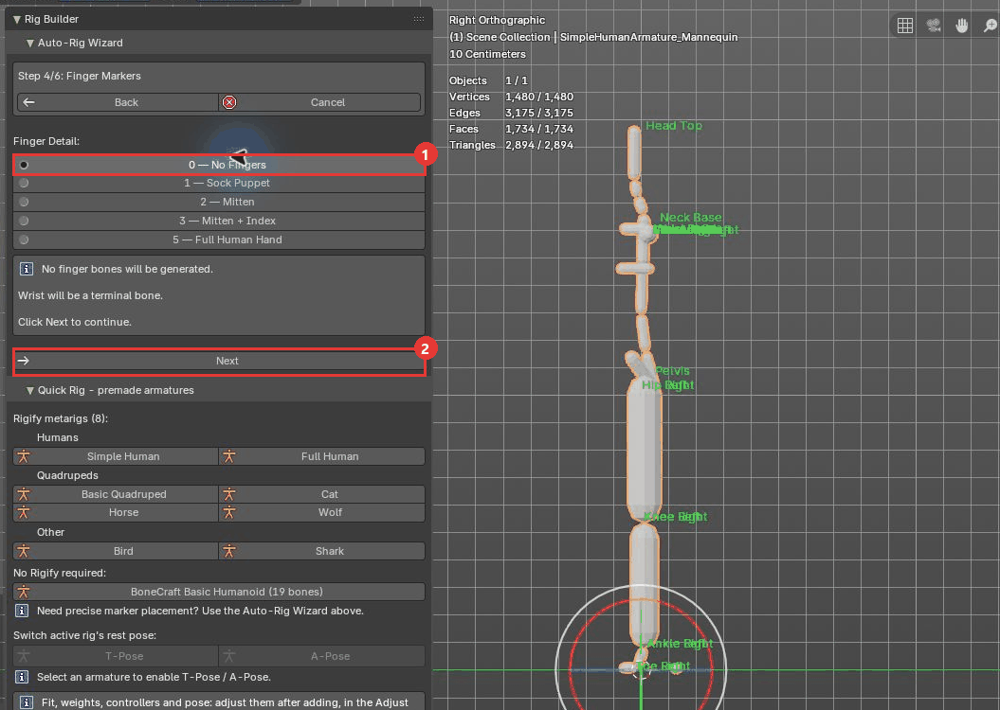

*1 — No Fingers. 2 — Next.*

#### B20. Review and generate

Require **All checks passed** before proceeding. Use **IK + FK**, control shapes on, `Spine Segments: 3`, `Neck Segments: 1`, `No Fingers`, and **Game Ready** for this exercise. Turn Twist Bones, Skirt Bones, Preserve Volume and Joint Correctives off. Click **Generate Rig**. These settings describe this simple training mannequin, not a universal export prescription.

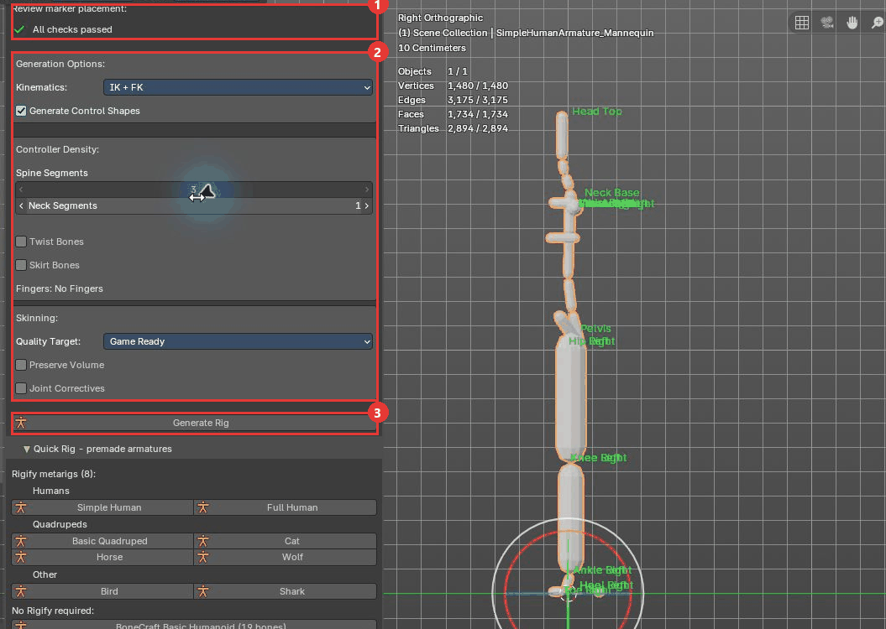

*1 — Marker checks. 2 — Generation settings. 3 — Generate Rig.*

#### B21. Build the animator controls

After generation, click **Build Control Rig**. Generate Rig supplies the body rig and weights; Build Control Rig adds the control layer used below. Do not click Quick Mannequin again—the input mesh is already present, even if the completion panel displays its generic mannequin offer.

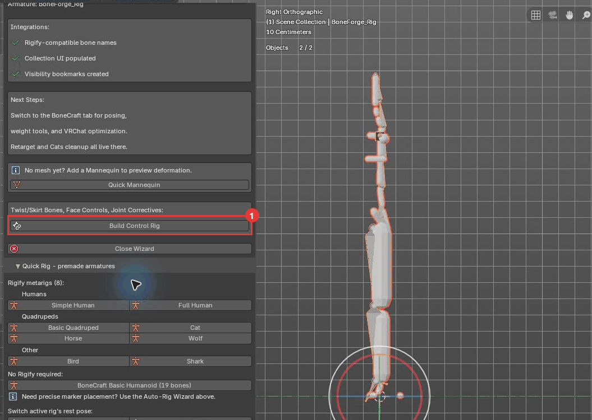

*1 — Build Control Rig.*

#### B22. Finish the wizard

Wait for the control-rig completion message, then click **Close Wizard**. The new armature appears in the Outliner. Keep the old Simple Human metarig hidden. The new rig must deform the mesh; merely seeing bones in the viewport is not sufficient validation.

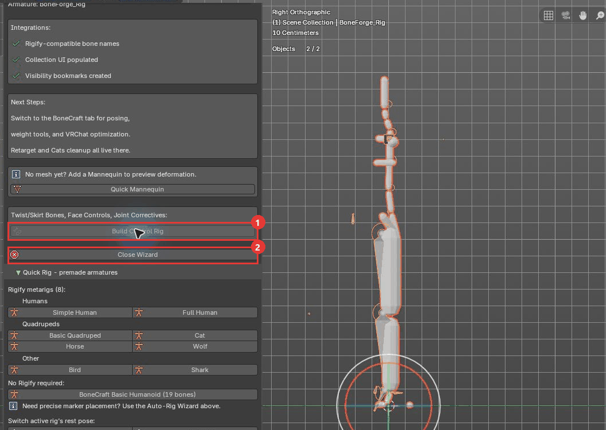

*1 — Build button is now disabled. 2 — Close Wizard.*

### Part C: Test weights and use IK/FK

The generated armature has this object name in the tested release (use it in the Outliner and the weight tool):

```text
BoneForge_Rig
```

`FK (Forward Kinematics)` follows rotations down a hierarchy: rotate the upper arm, then forearm, then hand. It suits broad swings and freely moving limbs. `IK (Inverse Kinematics)` starts at an endpoint: move a wrist or ankle target and the solver bends the chain to reach it. It suits planted feet and hands that must meet a surface.

| Task | Control to use | What to watch |
|---|---|---|
| Swing an arm | FK shoulder and elbow controls | Child controls follow their parent |
| Place a hand | IK wrist target | Shoulder and elbow solve toward the target |
| Plant a foot | IK ankle target for that leg | Move the body while the reachable target stays placed |
| Aim an elbow or knee bend | IK pole control | The pole sets the bend direction; it is not the wrist/ankle target |
| Change method | The limb’s IK/FK buttons | Check the snapped pose before keying animation |

The exercise below compares one arm in both modes. Each limb has its own switch. `Bake IK / Bake FK` are animation conversion tools; a single-pose switch does not replace baking or keying an animation. See [Control Layer](05-rig-tools.md#control-layer-ikfk) for the other controls.

#### C1. Open the control layer

Select **generated armature**, choose **Pose Mode**, then open **BoneCraft → Review → Control Layer**. There is a separate IK/FK switch for each arm and leg. Start with **arm-L → FK**. Left and right refer to the character, so arm-L appears on your right in front view.

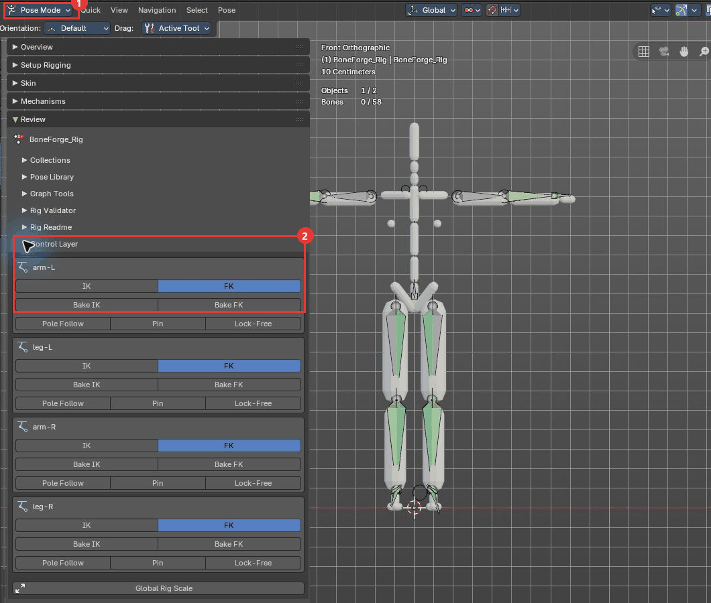

*1 — Pose Mode. 2 — Control Layer and arm-L switch.*

#### C2. Show the animator controls

Open the armature’s **Object Data Properties → Bone Collections**. Use the Solo stars for `Controls` and **FK** to isolate their control shapes. Enable **In Front** under Viewport Display when controls are obscured by the mesh. Later include **IK** when using targets. This native collection list also works if the BoneCraft Collections panel fails to draw in this host.

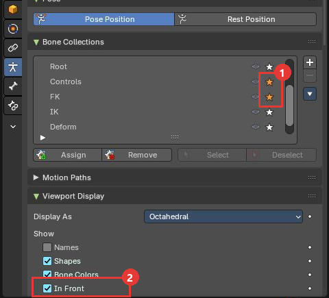

*1 — Controls and FK Solo stars. 2 — In Front.*

#### C3. Select the forearm FK control

In front view, click the circular control at the character’s left elbow. Check the viewport selection name is **forearm.fk-L**. An FK forearm control rotates around the elbow; selecting the shoulder control would rotate the upper arm and its children instead.

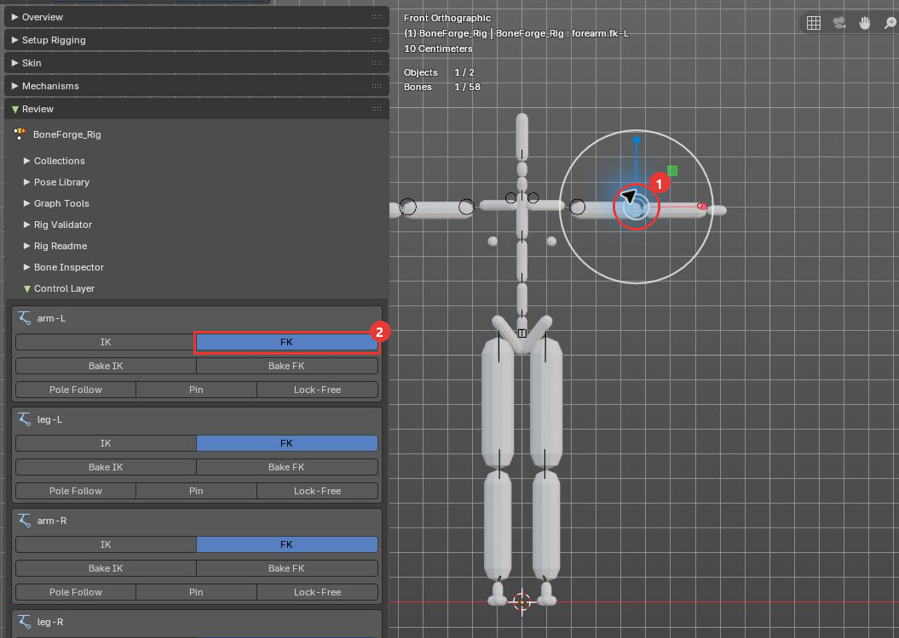

*1 — Selected forearm.fk-L control. 2 — FK is active for arm-L.*

#### C4. Rotate and inspect the deformation

Rotate the selected FK control about global **Y**, approximately `−45°` for this front-view example. Use the Rotate tool; in the shown Bforartists keymap, **Ctrl+E**, **Y**, type **-45**, then **Enter** performs that rotation. Blender’s default rotate shortcut is **R**. The screenshot deliberately shows the initial weight problem: the upper-arm capsule tilts with the forearm. Do not accept this as a finished rig.

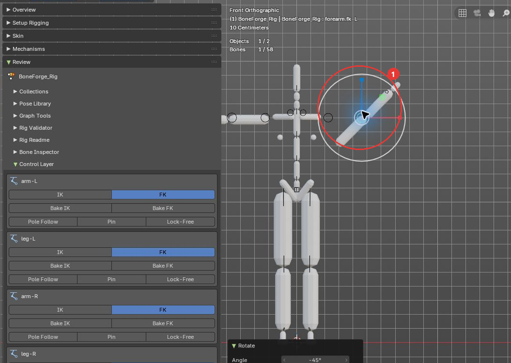

*1 — Incorrect upper-arm movement during the FK test.*

#### C5. Recalculate the mannequin weights

If the pose test above fails, switch to **Object Mode**, select the mesh, and open **BoneCraft → Skin → Weight Tools → Automatic Bone Weight Recalculation**. Set Mesh to Reweight to the mannequin and Existing Armature to **generated armature**. Choose **Body**, `Body Method: Bone Heat`, `New Weight Strength: 1.00`, `Smooth Passes: 0`, `Max Bones per Vertex: 0`, and `Minimum Weight: 0.001`. Keep **Keep Weight Backup** on, then run **Automatic Bone Weight Recalculation**. This repaired the segmented preview in the tested release.

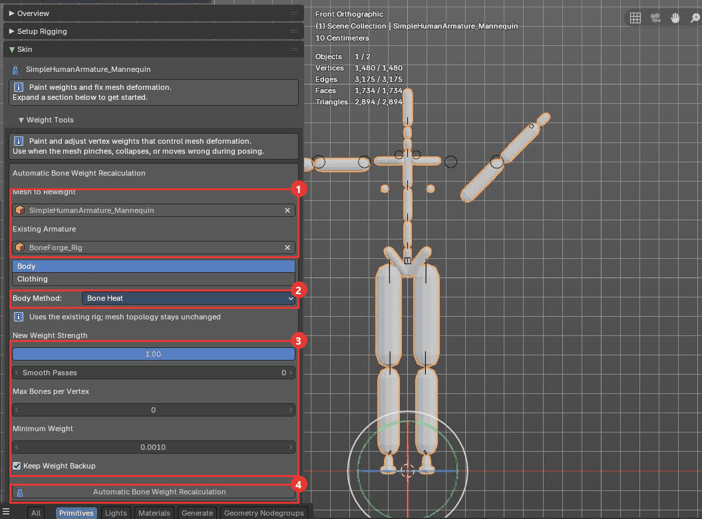

*1 — Mesh and armature. 2 — Bone Heat. 3 — Replacement settings and backup. 4 — Recalculate.*

#### C6. Verify the repaired FK bend

Select the generated armature again and return to **Pose Mode**. The upper arm should now stay horizontal from shoulder to elbow while the forearm rises from the elbow. The hidden `WEIGHTS_BACKUP_…` object preserves the old weights. Test other limbs too before using your own character in animation. A generated skeleton alone is not proof of correct skinning.

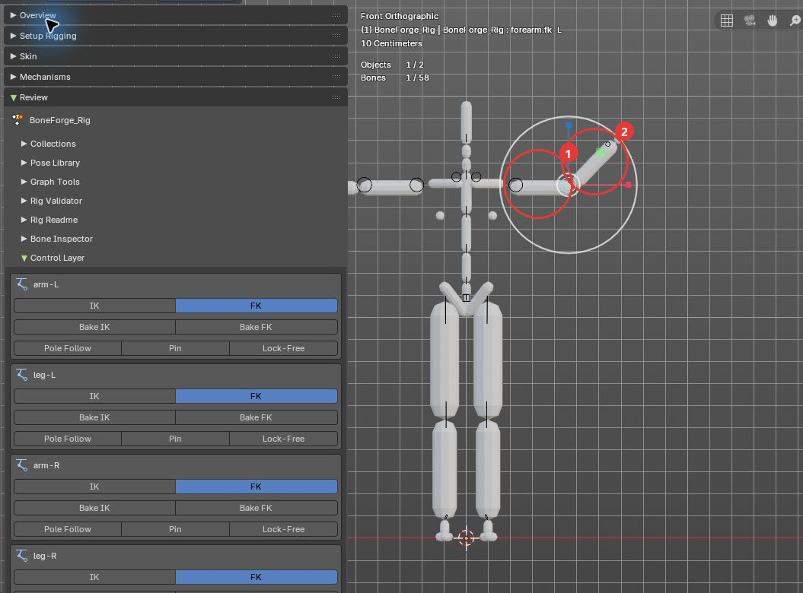

*1 — Upper arm stays in place. 2 — Forearm bends at the elbow.*

#### C7. Switch the same arm to IK

Click **arm-L → IK**. The switch snaps the target to the current pose, so the arm should remain in its raised pose. Add **IK** to the visible Solo collections if its targets are hidden. Switching changes which controls drive the chain; it does not mean a new animation has been recorded.

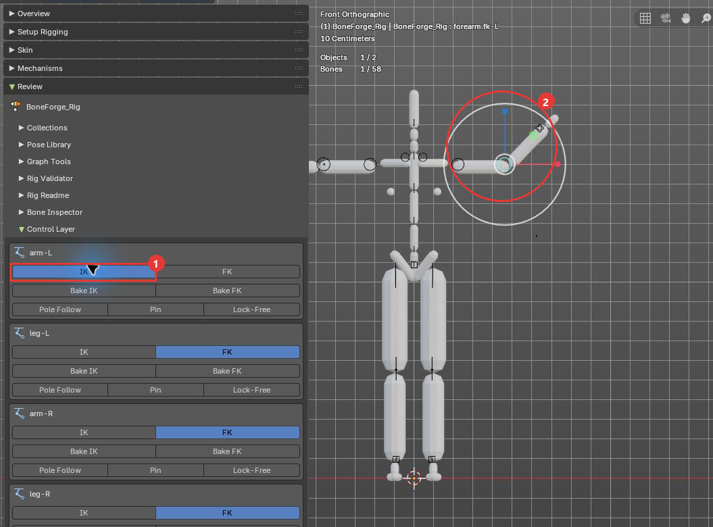

*1 — arm-L IK switch. 2 — Pose retained when switching.*

#### C8. Select the wrist IK target

Click the control at the wrist and check the selection name **forearm.ik-L**. Despite its forearm name, this is the endpoint target for the arm chain. Move this target to place the hand; the solver changes shoulder and elbow angles to reach it.

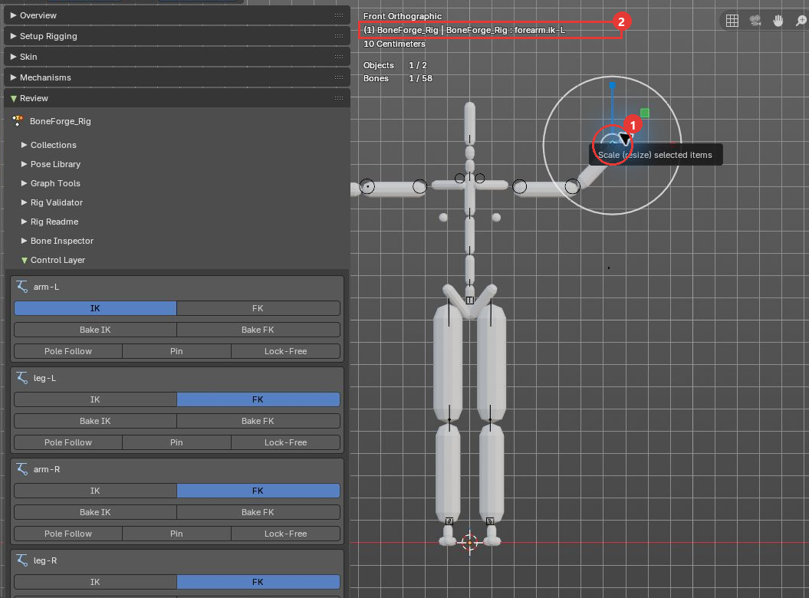

*1 — Selected wrist target. 2 — Selection name.*

#### C9. Move the target and compare

Move the wrist target slightly inward along global **X**. In this example, `−0.15 m` creates a visibly different bend. In the shown keymap use **Ctrl+W**, **X**, type `-0.15`, then **Enter**, or drag the Move tool’s X arrow. Blender’s default move shortcut is **G**. Compare the whole arm with the FK example: the endpoint leads and both arm segments follow. Keep the target within the arm’s reach.

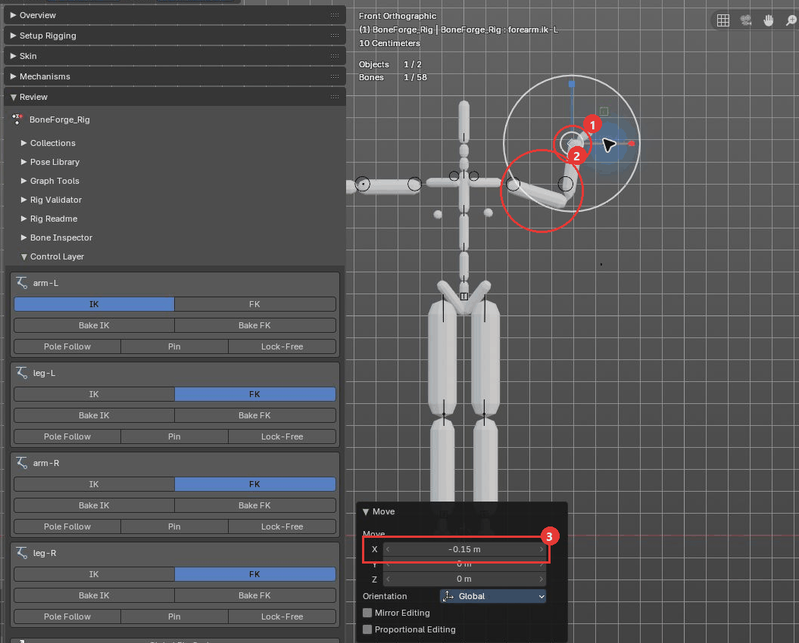

*1 — Wrist endpoint. 2 — Chain responds. 3 — Example X movement.*

#### C10. Switch back and save the example

Click **arm-L → FK** again. The FK controls snap to the current IK pose. Verify the mesh does not jump, then use **File → Save As** to save `Mannequin_AutoRig.blend`. The screenshot shows the saved example with FK active. For a neutral training copy, keep all four limbs in FK, select all visible pose controls and use **F3 → Clear Pose Transforms → All** as in Part A; save that under a separate name.

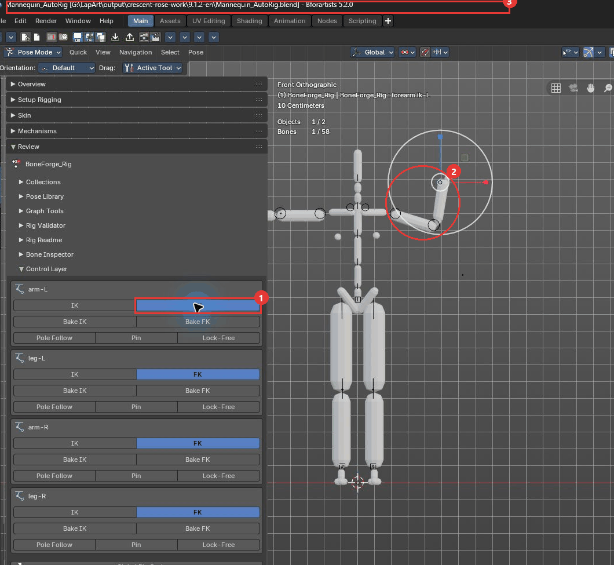

*1 — FK active again. 2 — Pose preserved. 3 — Saved file name.*

**Completion check:** you have preserved the original metarig preview, detached a rigless mannequin, generated a new body rig and its controls, corrected the preview weights, and compared an FK rotation with an IK target move. Keep the saved rig as a learning example; replace the preview with suitable character geometry for production.

---

### Animation Retargeting

Moving animation from one skeleton to another is covered in [Rig Tools: Retarget](05-rig-tools.md#retarget).

---

## Bone Merge

**What it does:** Combines two armatures into one — for example a body rig and a clothing or hair rig — keeping every weight.

[Guide 11](03-guides-b.md#guide-11-merge-two-rigs-together) walks through it step by step.

**The three stages:**
1. Scope — pick the two armatures and review how they differ
2. Rename — resolve name conflicts and mark new bones
3. Merge — preview, then merge

**Key controls:**
- **Base** — the armature that stays; the other armature merges into it and is then hidden
- **Analyze** — compares the two skeletons; **Acknowledge Scope — Proceed to Rename** opens stage 2
- **Normalize Both Armatures** — renames the standard bones of both rigs to one naming standard (Mixamo Prefixed, Mixamo Stripped or custom)
- **Auto-Propose Renames** — suggests names for the merging rig's own bones
- **Apply Rename** — renames one entry (one undo step); **Apply Batch Pattern** renames many with a pattern (with `{bone}`, `{side}` and `{index}`)
- **Mark as Unique** — keeps a bone as a new bone instead of merging it
- **Verify Rename — Proceed to Merge** — opens stage 3
- **Run Merge Preview** — reports what the merge would do, without changing anything
- **Merge Armatures** — backs up both armatures and merges them

**Where to find it:** BoneCraft → Setup Rigging → Bone Merge

Next: [Mechanisms](07-mechanisms.md)
