# チュートリアル：Mechanisms で Crescent Rose をリギング

[← 目次](index.md)

<!-- Print layout is scoped to this illustrated chapter; the shared renderer is unchanged. -->

## 作成するもの

Crescent Rose はライフルにもなる大鎌です。Mechanisms でモデルをリギングし、一つのスライダーで鎌からライフルへ、もう一つで収納形態へ変形させます。Gear Link を除く全種類を使います。Hinge 8 個、Slide 3 個、Telescope、Piston、Follow 各 1 個に、Sequence 2 個と Form 3 個です。

各形態はファンモデルの練習用ポーズです。Mechanisms は衝突検出や実機の機械設計を行いません。応用時は部品の干渉を確認してください。

完成例は `examples/crescent-rose/CrescentRose_Mechanisms.blend` です。いつでも開いて比較できます。

## 始める前に

 - ファイル：15 部品に分割済みの `examples/crescent-rose/CrescentRose_parts.blend` から始めます。`CrescentRose_Mechanisms.blend` は完成例です。
- 時間：FBX の準備と Mechanisms の実習を別の回に分け、段階ごとに保存します。速さを競う練習ではありません。
- 用語：先に [Mechanisms](07-mechanisms.md) の機能説明で部品、ジョイント、リンク、ハンドル、Sequence、Form を確認します。
- 言語：画像は英語版 Bforartists と英語の BoneCraft パネルです。BoneCraft は設定の **Language**、それ以外は Bforartists の言語に従います。未対応言語ではパネルが英語のままでも本書を利用できます。
- 開始点：元の FBX なら P1–P8、準備済みなら手順 1 へ進みます。どちらも同じ 15 部品を使います。
- 版：操作と実際の画面は BoneCraft `9.1.2`、Bforartists `5.2.0` の標準キーマップで確認しました。

赤い番号はクリック、入力、確認する場所です。画像ごとに 1、2、3 の順で操作します。番号は各画像で振り直します。枠は結果の確認、丸は操作対象です。

## 元の FBX を準備（P1–P8）

`CrescentRose_parts.blend` を使う場合は省略できます。新規ファイルを使い、FBX と `CrescentRoseTextures` を同じ場所に置きます。手順は Bforartists 5.2.0 の標準キーマップで再確認済みです。Tab は編集モードではなくオーバーレイを切り替える場合があるため、モードメニューを使います。

### P1 - FBX を読み込む

空のシーンで **File > Import > FBX (.fbx) (Legacy)** を選び、`CrescentRose.fbx` を Scale `1.00` で読み込みます。この手順では Legacy を使います。Outliner にルートと `Black01`、`Blades01`、`Red01` の 3 メッシュが現れます。Numpad 3 で右面、Home で全体を表示します。

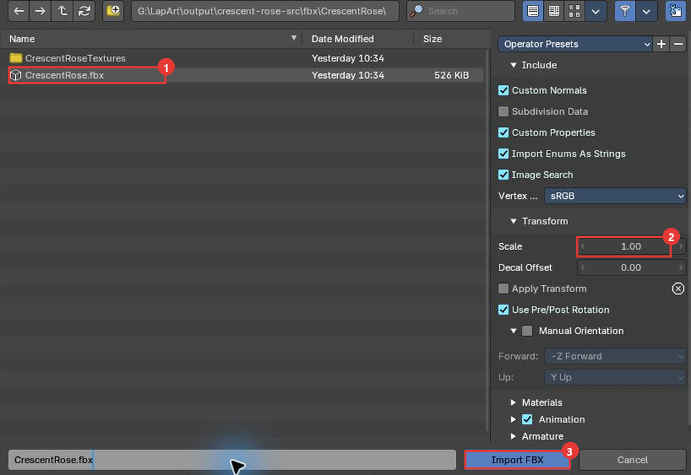{style="max-width:100%;max-height:155mm;width:auto;height:auto"}

*1：CrescentRose.fbx を選択。2：Scale は 1.00。3：Legacy の Import FBX を実行。*

### P2 - 位置を保って寸法を設定

Object Mode で 3 メッシュを選択し **Object > Parent > Clear and Keep Transformation** を実行、不要なルートを削除します。3 個すべてに **Object > Apply > Rotation & Scale** を適用。元の高さは約 `0.32 m` です。まとめて `6.25` 倍にします（このキーマップでは Ctrl+R、6.25、確定）。再び Rotation & Scale を適用すると全高約 `1.997 m` です。一度だけ行います。準備済みファイルは拡大済みです。

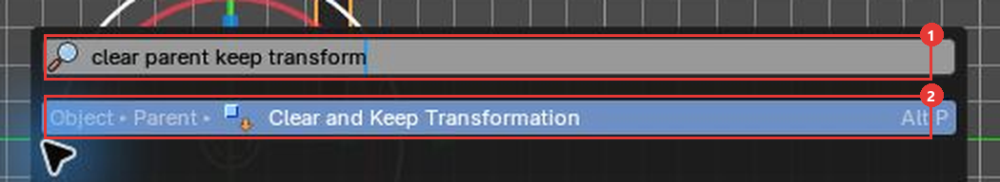{style="max-width:100%;max-height:135mm;width:auto;height:auto"}

*1：F3 で Clear Parent Keep Transform を検索。2：Clear and Keep Transformation を選択。3 メッシュすべてに実行してからルートを削除。*

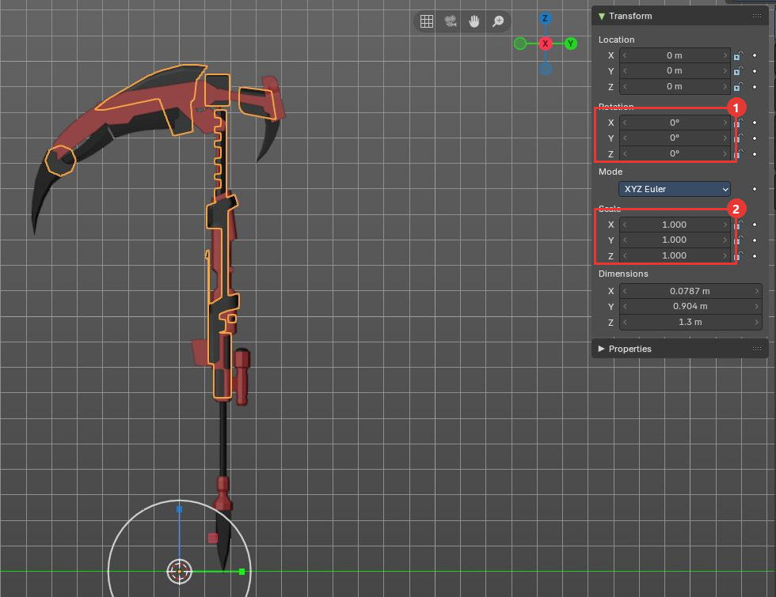{style="max-width:100%;max-height:115mm;width:auto;height:auto"}

*1：3 メッシュを 6.25 倍後 Rotation & Scale を適用し Rotation 0 を確認。2：全軸 Scale 1 を確認。*

個別の Dimensions は各材質メッシュだけの寸法です。武器の高さは全体の上下端で測ります。分離前に 3 個とも回転 0、スケール 1 を確認します。

### P3 - マテリアルを接続

Shading と Material Preview に切り替えます。3 材質それぞれで `CrescentRoseTextures` の `BaseColor`、`Metallic`、`Roughness`、`Normal` を読み、Image Texture の Color を対応する Principled BSDF 入力へ接続します。BaseColor は **sRGB**、他は `Non-Color`。Normal には **Normal Map** を挟み `Tangent Space` のまま画像 Color → Color、Normal → BSDF Normal と接続します。既存 UV は保持します。

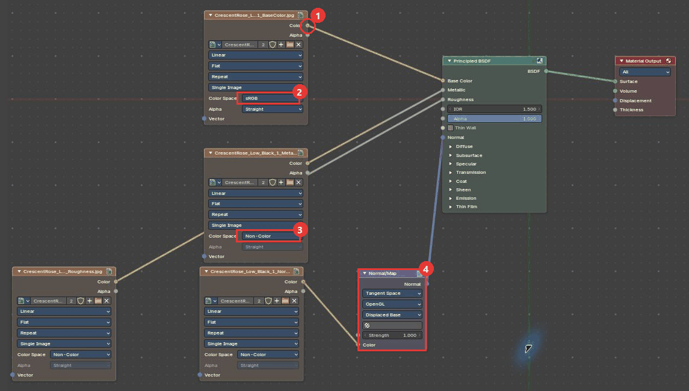{style="max-width:100%;max-height:155mm;width:auto;height:auto"}

*1：BaseColor の Color を BSDF Base Color へ。2：BaseColor は sRGB。3：データ画像は Non-Color。4：Normal 画像 → Normal Map → BSDF Normal、Tangent Space を使用。*

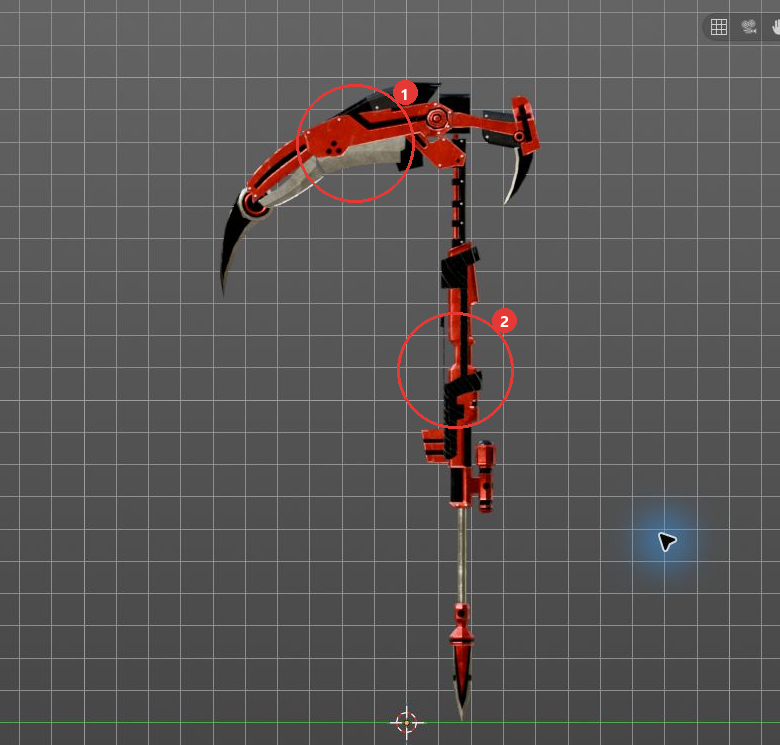{style="max-width:100%;max-height:155mm;width:auto;height:auto"}

*1：刃の材質を確認。2：Material Preview で赤黒の本体を確認し、画像欠落のピンクがないこと。*

刃と赤い材質にも同様に接続します。色空間は画像単位の設定なので選択後に確認します。赤、黒、金属が見え、欠落画像のピンクがないことを確認します。

### P4 - 非連結部品を分離

3 メッシュを選び、モードメニューから **Edit Mode** へ。全形状を選択し **Mesh > Separate > By Loose Parts**、Object Mode に戻ります。**37** メッシュになります。接尾番号は変わるので形と位置で識別します。

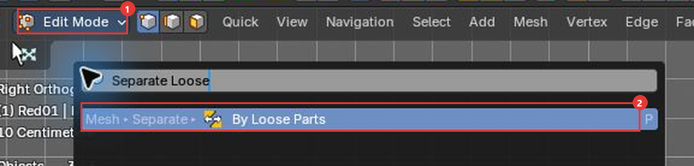{style="max-width:100%;max-height:135mm;width:auto;height:auto"}

*1：Edit Mode で全選択。2：F3 で Separate Loose を検索し By Loose Parts。*

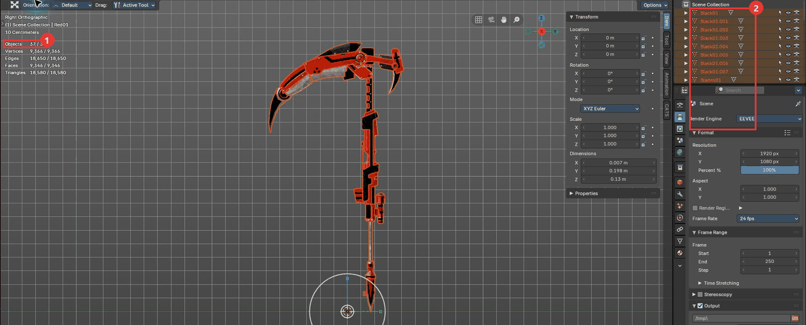{style="max-width:100%;max-height:155mm;width:auto;height:auto"}

*1：分離後 37 個か確認。2：Outliner で形と場所から選択。番号は異なる場合があります。*

### P5 - 15 の可動グループに結合

一緒に動く部品だけを選び **Object > Join**（Ctrl+J）、Outliner で改名します。両面の対になる部品は視点を回し両方を選び、結合前に確認。刃先から内側、本体、柄の順に進みます。表は全ソース島を示し、材質名は外観を表すもので最終名ではありません。

| 最終名 | 結合する部品 | 頂点数 |
|---|---|---:|
| `BladeTip` | 黒い先端関節ノブと金属の先端 | 252 |
| `Blade2` | 金属の第2段板2枚と赤カバー2枚 | 1000 |
| `Blade1` | 頭に近い第1段の金属板2枚 | 512 |
| `HeadMount` | 黒い後部、上蓋、芯、赤い内板2枚と薄い上カバー2枚 | 1395 |
| `PlateL` | 負X側の赤い外板1枚 | 676 |
| `PlateR` | 正X側の赤い外板1枚 | 676 |
| `RearSpike` | 金属突起2枚、赤い支点カバー2個と取付板2枚 | 1194 |
| `Receiver` | 黒い本体と小ノブ、ボルト上の金属環、長い赤カバー | 2609 |
| `Grip` | 本体下の赤いグリップ | 194 |
| `Magazine` | 本体下の黒い筒 | 96 |
| `Bolt` | 赤いボルト筒とノブ2個 | 362 |
| `Pole` | 金属の下柄と赤い環 | 148 |
| `ButtSpike` | 底の金属突起 | 110 |
| `StrutBase` | 本体と頭の間の赤い細棒 | 34 |
| `StrutRod` | 棒を囲む黒い溝付きスリーブ | 108 |

合計 **15 メッシュ、9,366 頂点** が必要です。外板を Blade1 に混ぜず、支柱 2 個も結合しません。支柱は既に別々なので二分割は不要です。手順 2 に最終名と親子関係があります。

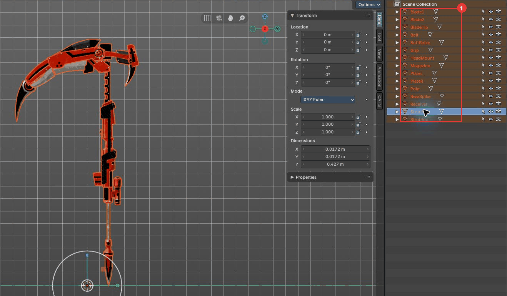{style="max-width:100%;max-height:155mm;width:auto;height:auto"}

*1：結合した各グループを表の 15 名に改名。*

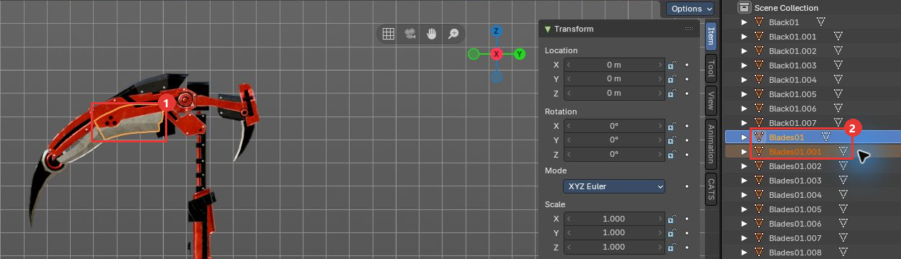{style="max-width:100%;max-height:155mm;width:auto;height:auto"}

*1：両側の金属 Blade1 板を選択。2：両方の選択を確認して Join、Blade1 に改名。*

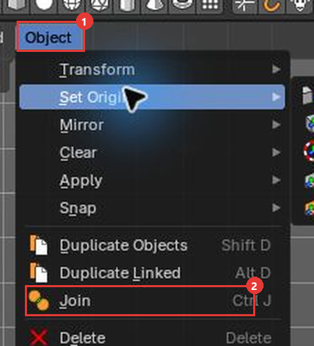{style="max-width:100%;max-height:135mm;width:auto;height:auto"}

*1：1 グループの部品だけ選んで Object。2：Join（Ctrl+J）。この画像はコマンド位置を示すものです。上図の 2 部品を選択して実行します。*

### P6 - 原点を中央へ

Object Mode で 15 メッシュを選択し **Object > Set Origin > Origin to Geometry**、Center を `Bounds Center` にします。回転 0、スケール 1 を確認。まだ親もアーマチュアもありません。これは準備用の原点で、手順 6 で実際の関節へ移します。

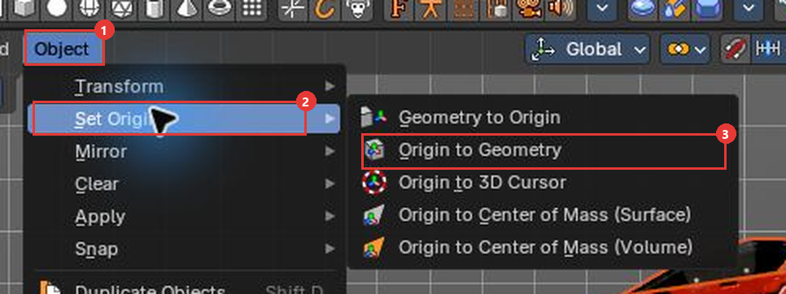{style="max-width:100%;max-height:135mm;width:auto;height:auto"}

*1：Object。2：Set Origin。3：Origin to Geometry を選び、操作設定を Bounds Center に。*

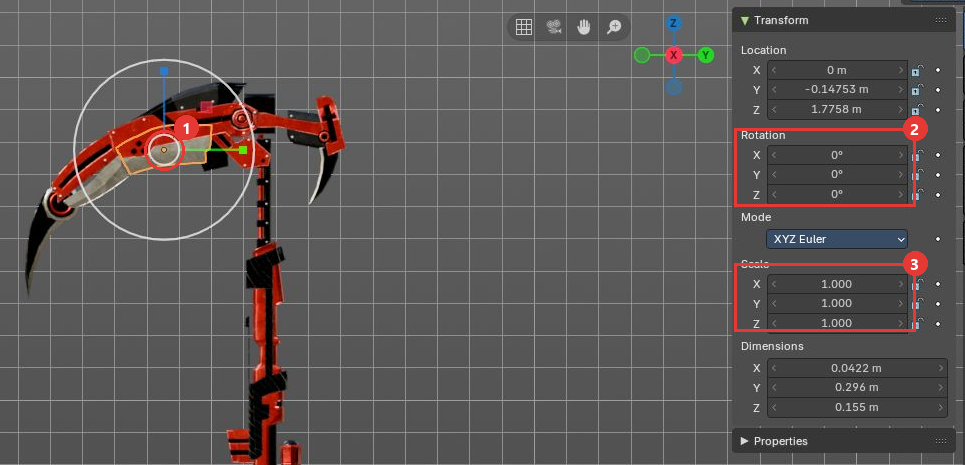{style="max-width:100%;max-height:155mm;width:auto;height:auto"}

*1：オレンジの原点が形状中央に。2：Rotation 0。3：Scale 1。機構の支点は後で移動。*

### P7 - テクスチャの縮小とパック

Image Editor で使用中の **12 画像**（各材質 4 枚）を一枚ずつ **Image > Resize**、縦横 **1024** にして **Image > Pack**。全画像で繰り返します。縮小画像を blend に保存し、元 JPEG は上書きしません。Material Preview を確認します。

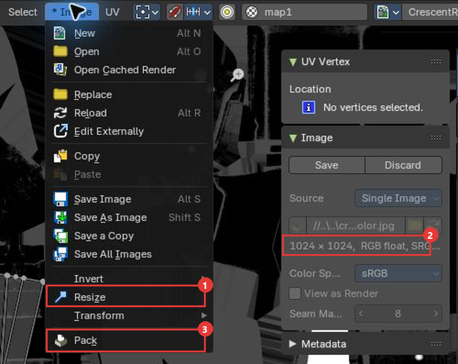{style="max-width:100%;max-height:155mm;width:auto;height:auto"}

*1：Image > Resize で縦横 1024。2：1024 x 1024 を確認。3：Pack。12 枚全部に実行。*

### P8 - 準備ファイルを保存して再読込

作業コピーを `CrescentRose_parts.blend` として保存。再読込し 15 個の名前、変換、赤黒の材質を確認します。元画像フォルダーに依存せず 12 枚が利用できること。右面と Home に戻して手順 1 へ。

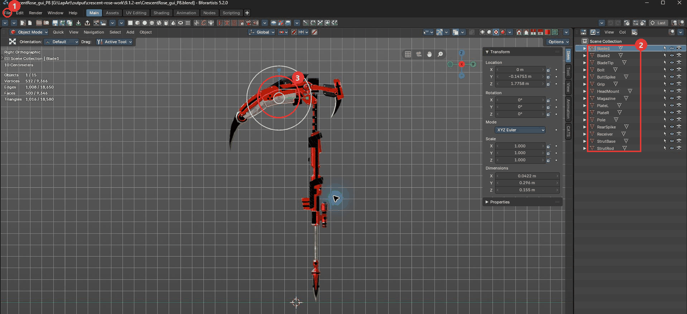{style="max-width:100%;max-height:155mm;width:auto;height:auto"}

*1：File の Save As、Open で再読込。2：15 個の名前を確認。3：材質とタイトルバーのファイル名を確認。*

## A. ファイルを開く

### 手順 1 — 部品ファイルを開く

`examples/crescent-rose/CrescentRose_parts.blend` を開き Material Preview、Numpad 3 で右面へ。刃は左、底の突起は下です。Home で全体表示。

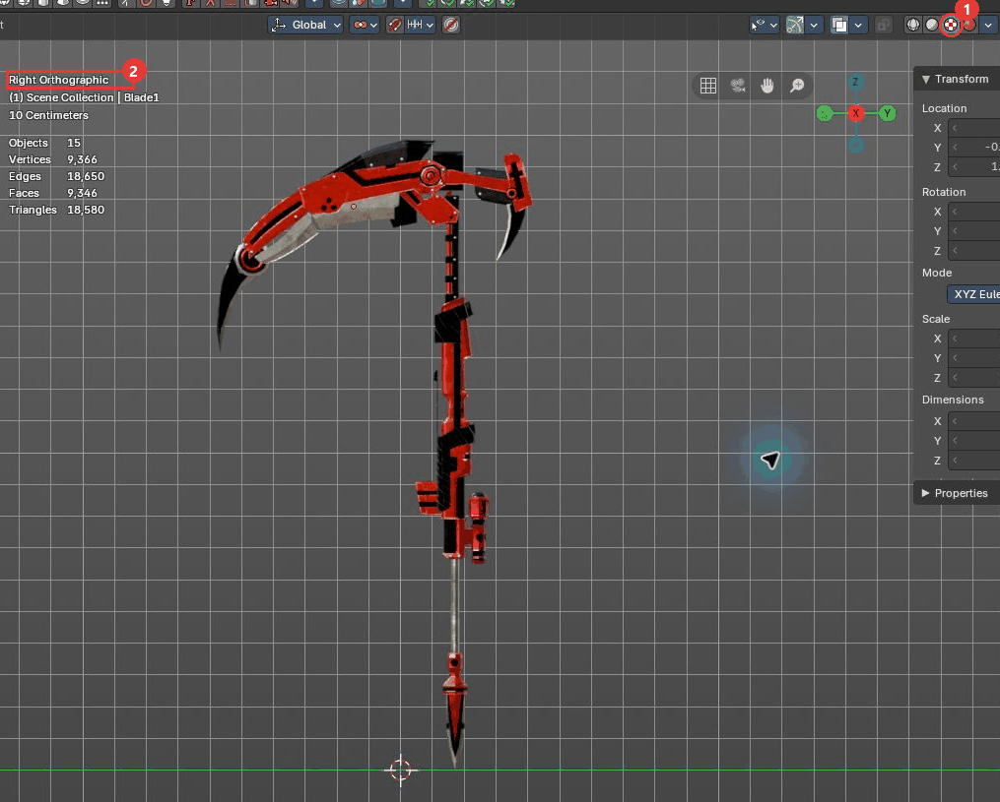{style="max-width:100%;max-height:155mm;width:auto;height:auto"}

*1：Material Preview。2：Numpad 3 で Right Orthographic、Home で武器全体を表示。*

**確認：** 高さ約 2 m の赤黒の鎌。選択はありません。

### 手順 2 — 部品を確認

Outliner の 15 個はそれぞれ一体として動きます。

| オブジェクト | 内容 | Rides on |
|---|---|---|
| `Receiver` | スコープ、引き金、照準付き本体 | `the rig` |
| `Grip` | 本体下のグリップ | `Receiver` |
| `Magazine` | 円筒弾倉 | `Receiver` |
| `Bolt` | ボルト | `Receiver` |
| `Pole` | 下柄と環 | `Receiver` |
| `ButtSpike` | 底の突起 | `Pole` |
| `HeadMount` | 刃を支える頭部 | `Receiver` |
| `Blade1` | 頭に近い第1刃 | `HeadMount` |
| `Blade2` | 第2刃 | `Blade1` |
| `BladeTip` | 刃先 | `Blade2` |
| `RearSpike` | 頭の後方突起 | `HeadMount` |
| `PlateL`, `PlateR` | 頭の外側板 | `HeadMount` |
| `StrutBase` | 本体と頭の間の細棒 | `Receiver` |
| `StrutRod` | 棒を囲む溝付きスリーブ | `HeadMount` |

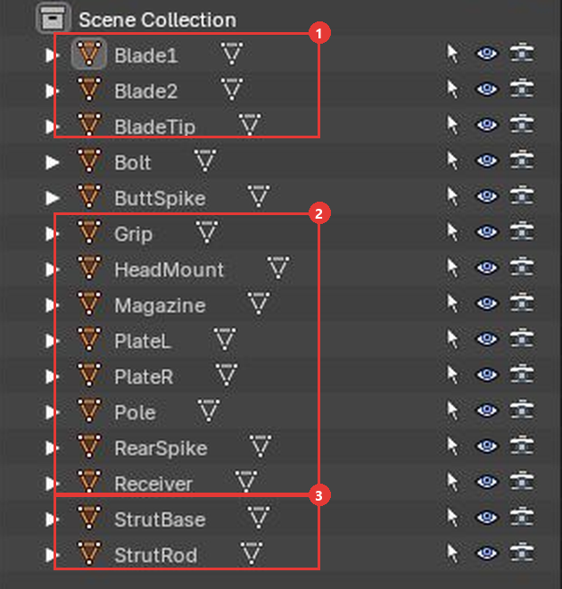{style="max-width:100%;max-height:155mm;width:auto;height:auto"}

*1：刃の 3 段を確認。2：本体、頭部、柄の名前を表で確認。3：StrutBase と StrutRod は別々に保持。*

元 FBX は P1–P8 に従います。準備ファイルもこの画面操作で作成しており、リポジトリの準備スクリプトには分類表があります。

### 手順 3 — Mechanisms を表示

左 Tool Shelf の BoneCraft で **Mechanisms** を展開。非表示なら視点上で T、Region Toggle の Tools を選びます。右端をドラッグして幅を広げます。設定で Scene Properties を Show にすれば **Properties > Scene** でも利用できます。画像は Tool Shelf です。メッシュ選択中でリグがなければ上部の **Add Parts from Selection** を探します。手順 4 で全選択してから実行すると番号付きの各欄が使用可能になります。

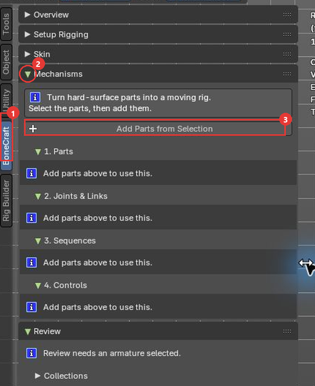{style="max-width:100%;max-height:155mm;width:auto;height:auto"}

*1：BoneCraft。2：Mechanisms を展開。3：Add Parts from Selection を確認し、先にメッシュを選択。*

## B. 部品

### 手順 4 — Add Parts from Selection

視点上で A、15 個を選び **Add Parts from Selection**。

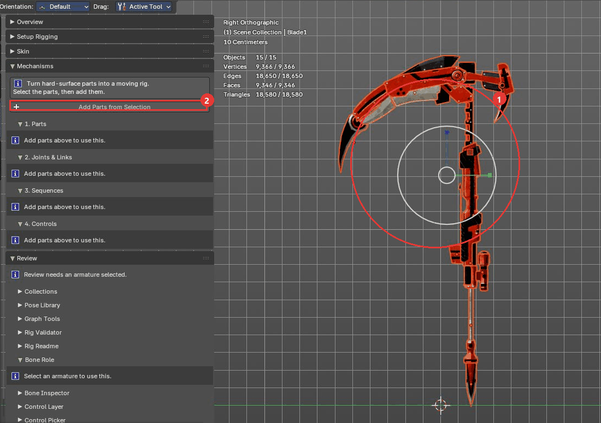{style="max-width:100%;max-height:155mm;width:auto;height:auto"}

*1：視点上で A、15 メッシュを選択。2：Add Parts from Selection。*

**確認：** Outliner に「Mechanism Rig」とその下の部品が現れます。メッシュの選択は保たれます。**1. Parts** に 15 個、BoneCraft 上部に折りたためる Overview が表示されます。

### 手順 5 — Rides on の親

部品は取り付け先とともに動きます。**1. Parts** で `Blade1`、下の Rides on で `HeadMount`。手順 2 の全項目に繰り返し、`Receiver` は「the rig」のままにします。

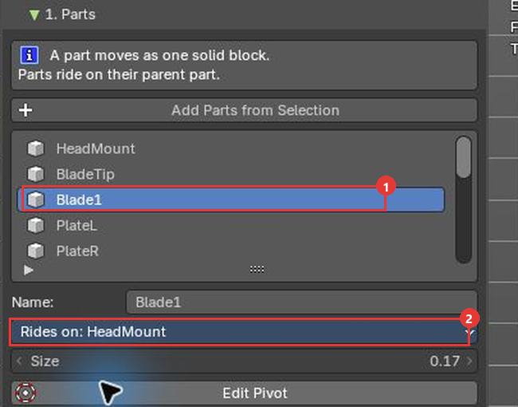{style="max-width:100%;max-height:155mm;width:auto;height:auto"}

*1：Parts の Blade1。2：Rides on を HeadMount。親の表に従って反復。*

### 手順 6 — 支点

Hinge は部品の支点で回ります。刃、頭、グリップは中心でなく関節を使います。`Blade1` を選び **Edit Pivot**、マーカーを選び Ctrl+W で頭との接続へ移して **Apply Pivot**。正投影の側面で横位置を保ちます。`Blade2` は Blade1 接続、`BladeTip` は Blade2 接続、`HeadMount` は下端の支柱接続、`Grip` は上端、`RearSpike` は頭との接続、`PlateL` と `PlateR` は Blade1 接続の丸いボルト中央、`StrutBase` は下端、`StrutRod` は上端へ。画像は目安で数 mm の差は見た目に影響しません。

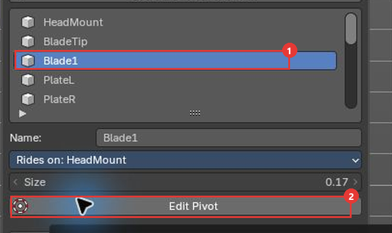{style="max-width:100%;max-height:135mm;width:auto;height:auto"}

*1：Parts の Blade1。2：Edit Pivot、次の図で移動と適用。*

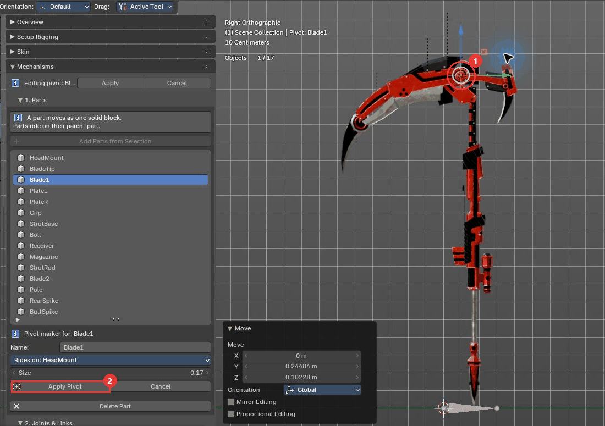{style="max-width:100%;max-height:155mm;width:auto;height:auto"}

*1：Ctrl+W で刃の関節へ。2：Apply Pivot で確定。*

## C. 頭部

### 手順 7 — Add Joint → Hinge

**Add Joint → Hinge** でガイド開始。ヘッダーとステータスバーが次の操作を示します。

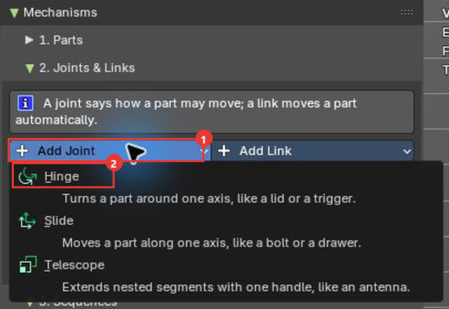{style="max-width:100%;max-height:155mm;width:auto;height:auto"}

*1：Add Joint。2：Hinge。部品選択待ちになります。*

### 手順 8 — 頭部をクリック

「click the part that turns」の指示で、右面では外板に隠れた頭部の後ろの黒い塊（丸）を選びます。`PlateR` と出たら Esc、**Add Joint > Hinge** をやり直しさらに後ろをクリック。遮蔽物はガイド前に隠します。ガイド中は通常のキー操作が取り込まれます。

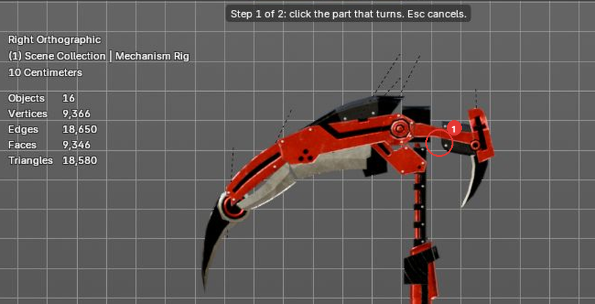{style="max-width:100%;max-height:155mm;width:auto;height:auto"}

*1：赤い外板の後ろの黒い HeadMount をクリック。表示名を確認。*

### 手順 9 — X、Enter

軸の指示で X。頭が横軸まわりに繰り返しプレビューされ、Enter で確定。

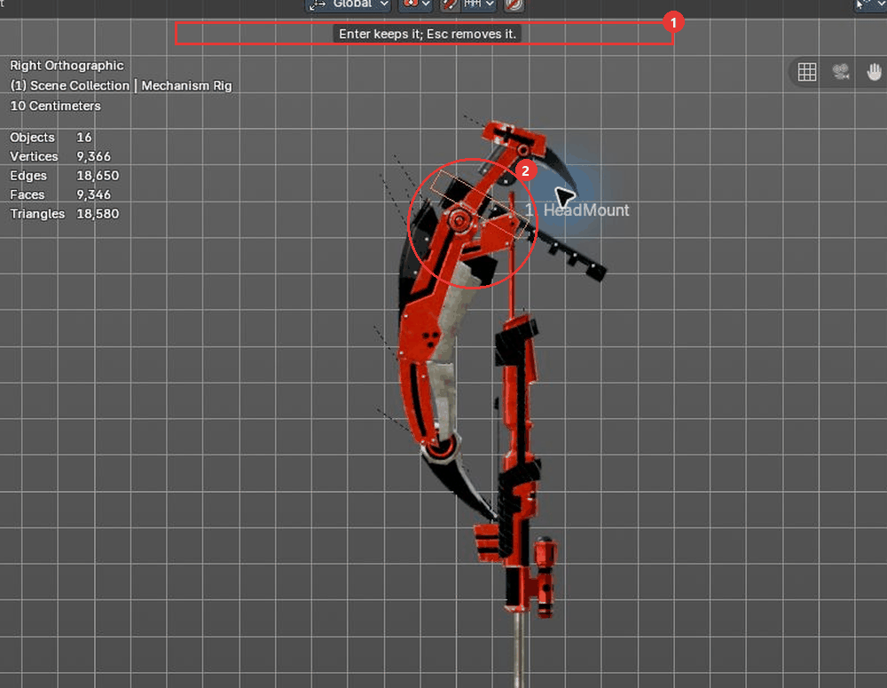{style="max-width:100%;max-height:155mm;width:auto;height:auto"}

*1：X、Enter。2：確定前に支点まわりの回転を確認。*

**確認：** **2. Joints & Links** の `HeadMount Hinge` と **4. Controls** のスライダー。スライダーは Object Mode、ボーンハンドルはアーマチュアを選び Pose Mode で操作します。

### 手順 10 — 制限

`HeadMount Hinge` の **Min** 0、**Max** 120。正方向は下と後ろです。制限は 120 度のまま、Rifle シーケンスでは刃と組み合わせて 90 度を使います。

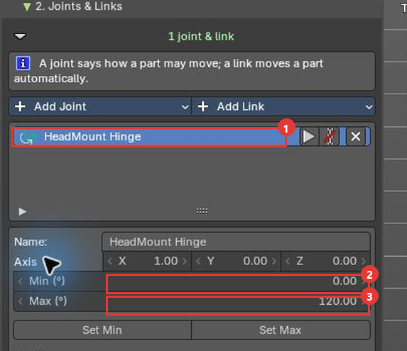{style="max-width:100%;max-height:155mm;width:auto;height:auto"}

*1：HeadMount Hinge。2：Min 0。3：Max 120。数値をダブルクリックし入力、Enter。*

### 手順 11 — テスト

行の再生ボタンで頭が 120° まで往復し、元のポーズに戻ります。

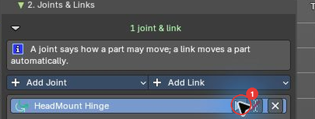{style="max-width:100%;max-height:155mm;width:auto;height:auto"}

*1：HeadMount Hinge 行の小さい再生三角を押し往復を確認。*

## D. 刃のチェーン

### 手順 12 — さらに 3 個のヒンジ

`Blade1`、`Blade2`、`BladeTip` に手順 7–10 を反復。**Add Joint → Hinge**、部品、X、Enter、**Max** 120。それぞれ前の段を親としてチェーンになります。

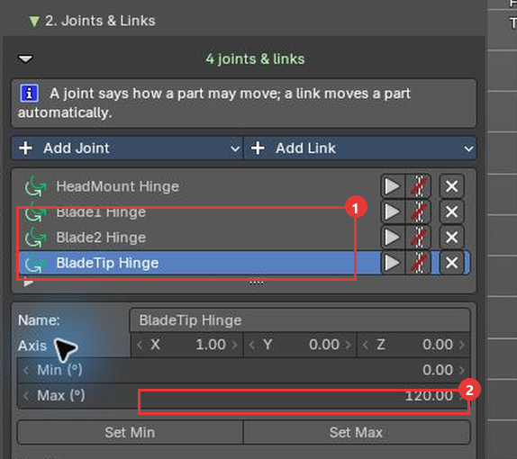{style="max-width:100%;max-height:155mm;width:auto;height:auto"}

*1：3 段の Hinge を作成して選択。2：各 Max 120、軸 X。*

### 手順 13 — チェーンを試す

**2. Joints & Links** を閉じ **4. Controls** を開きます。Object Mode で刃 3 個の Hinge を順に 60 度へ。数値をダブルクリック、Ctrl+A、入力、Enter。後続が親とともに曲がります。次へ進む前にすべて 0。

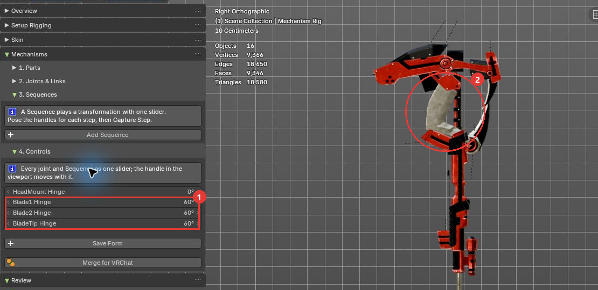{style="max-width:100%;max-height:155mm;width:auto;height:auto"}

*1：3 個の刃スライダーを 60 に。2：連動する曲がりを確認してすべて 0。*

## E. 側板と支柱

### 手順 14 — 側板のヒンジ

`PlateR` に Hinge、**Max** 30。右面で隠れる `PlateL` は Ctrl+Numpad 3 で左面にして追加し、Numpad 3 で戻ります。

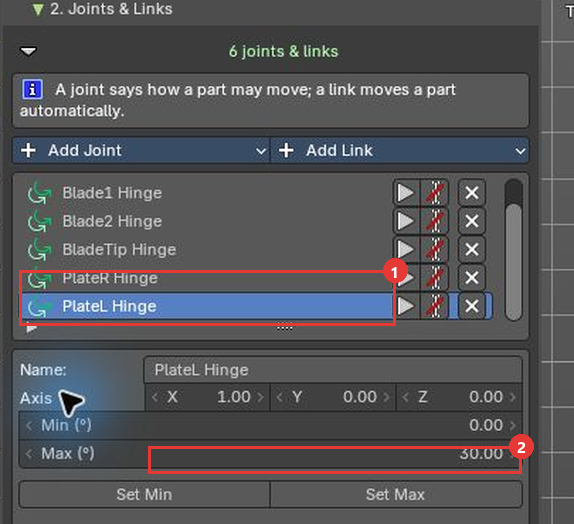{style="max-width:100%;max-height:155mm;width:auto;height:auto"}

*1：両板に Hinge。PlateL は反対側から。2：各 Max 30。*

### 手順 15 — Add Link → Follow

1 ハンドルで両板を動かします。ガイド前に Numpad 1、`Blade2` を選び F3 > Frame Selected で頭部を拡大。両板が左右端に見えます。**Add Link > Follow**、左端の `PlateL`（先導）、右端の `PlateR`（追従）の順で選び Enter。

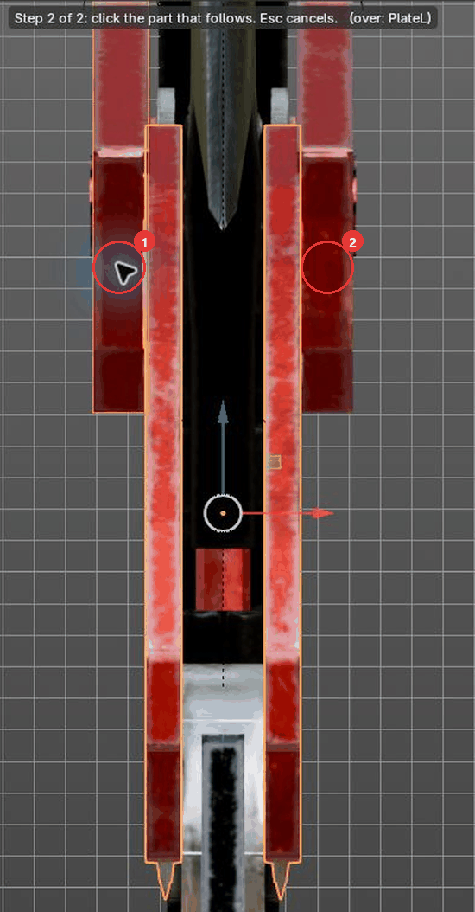{style="max-width:100%;max-height:155mm;width:auto;height:auto"}

*1：先に PlateL。2：次に PlateR、Enter。*

### 手順 16 — 範囲

Follow を選び、自動設定の **Source Range** 0…30、**Target Range** 0…30 を確認。**Name** を `PlateR Follow` に。

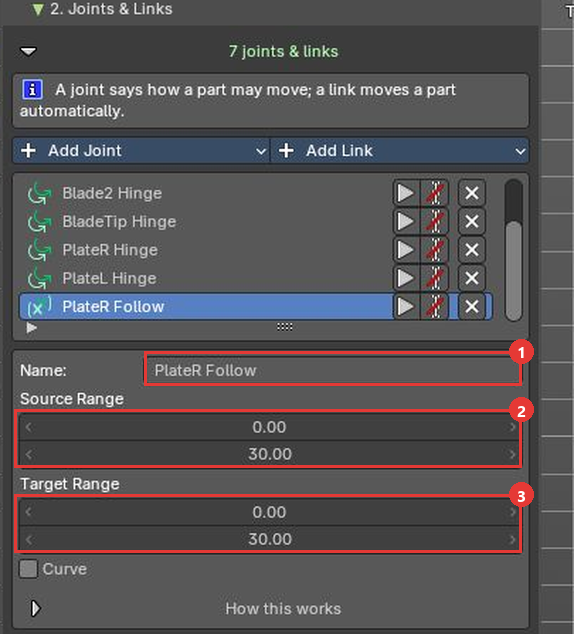{style="max-width:100%;max-height:155mm;width:auto;height:auto"}

*1：PlateR Follow に改名。2：Source Range 0–30。3：Target Range 0–30。*

### 手順 17 — Add Link → Piston

頭が折れる間も支柱は本体と頭の間を向きます。ガイド前に Numpad 3、Outliner の `StrutRod`、F3 > Frame Selected。その後 **Add Link > Piston**。ガイド中は移動キーが使えないので先に拡大します。

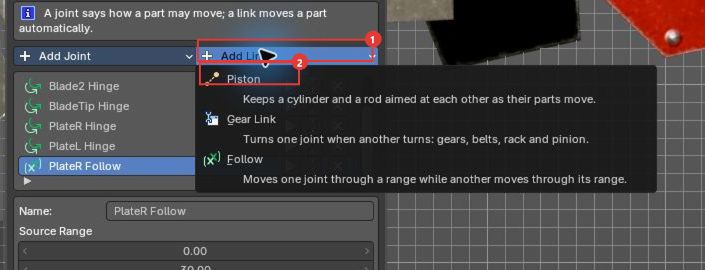{style="max-width:100%;max-height:155mm;width:auto;height:auto"}

*1：StrutRod を拡大して Add Link。2：Piston、最初は cylinder。*

### 手順 18 — シリンダーとロッド

最初の cylinder は `StrutBase`、溝から見える赤い細棒。次の rod は黒いスリーブ `StrutRod`。拡大画面でこの順に選びます。ガイドの cylinder/rod はリンク端の役割で、オブジェクト名は元部品の名前です。Enter、`Head Strut` に改名、**Stretch** はオフ。

**確認：** Controls の `HeadMount Hinge` を動かすと支柱 2 個が互いを向いて追従。確認後 0。

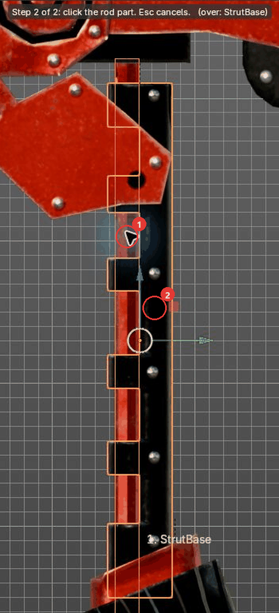{style="max-width:100%;max-height:100mm;width:auto;height:auto"}

*1：露出した赤い StrutBase。2：黒い StrutRod、Enter。*

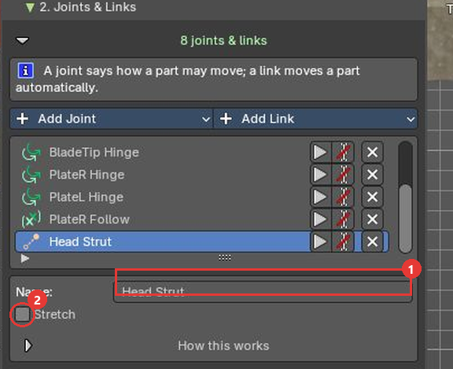{style="max-width:100%;max-height:70mm;width:auto;height:auto"}

*1：Head Strut に改名。2：Stretch オフ、HeadMount Hinge を試して 0。*

## F. ライフル

### 手順 19 — グリップと後方突起

`Grip` に **Add Joint → Hinge**、X、Enter、**Min** 0、**Max** 90。`RearSpike` にも同様に追加。その `RearSpike Hinge` の **Axis X** を **-1**、Y、Z は 0 にして Compact で頭へ向かい逆折りにします。Grip は正 X。両 Hinge が一覧にあること。手順 25 で収納形態に使います。

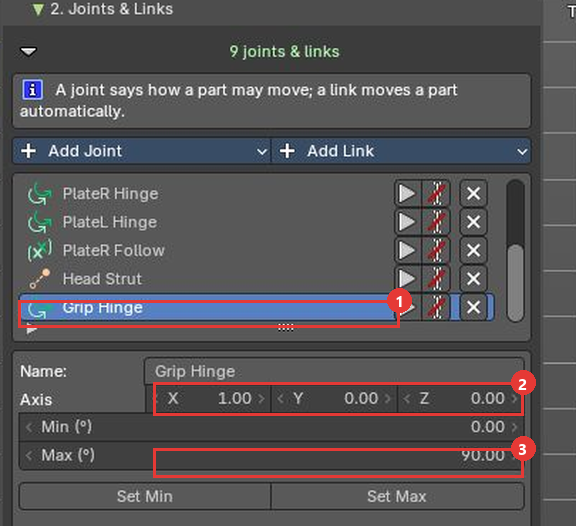{style="max-width:100%;max-height:110mm;width:auto;height:auto"}

*1：Grip Hinge。2：X 1、Y/Z 0。3：Max 90、Min 0。*

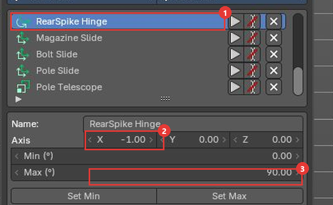{style="max-width:100%;max-height:155mm;width:auto;height:auto"}

*1：RearSpike Hinge。2：X -1。3：Max 90、Min 0。*

### 手順 20 — 弾倉とボルトの Slide

`Magazine` に **Add Joint → Slide**、Z、Enter、**Max** 0.04。`Bolt` も Z の Slide、**Max** 0.06。単位はシーン単位で 0.06 は 6 cm です。

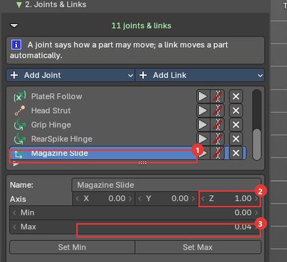{style="max-width:100%;max-height:155mm;width:auto;height:auto"}

*1：Magazine Slide を作成選択。2：Z 1、X/Y 0。3：Max 0.04、Min 0。*

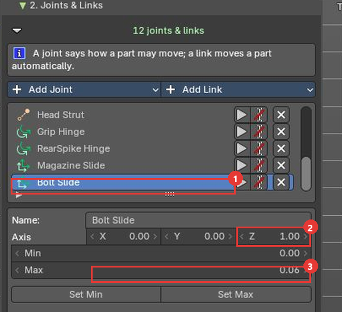{style="max-width:100%;max-height:155mm;width:auto;height:auto"}

*1：Bolt Slide を作成選択。2：Z 1、X/Y 0。3：Max 0.06、Min 0。*

### 手順 21 — Pole Slide

`Pole` に Slide、Z、Enter、**Max** 0.6。正で柄が本体へ上に縮みます。**4. Controls** の `Pole Slide` を 0.6 にして確認後 0。

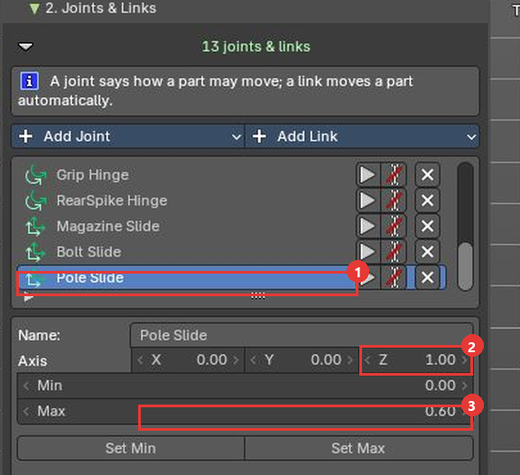{style="max-width:100%;max-height:155mm;width:auto;height:auto"}

*1：Pole Slide を作成選択。2：Z 1、X/Y 0。3：Max 0.6、Min 0。*

### 手順 22 — Pole Telescope

**Add Joint → Telescope**、`Pole`（base）、`ButtSpike`（segment）、Enter、Z、Enter。**Length** 0.2。別ハンドルで底の突起が正 Z に最大 20 cm 柄の中へ移動します。試して 0 に戻します。

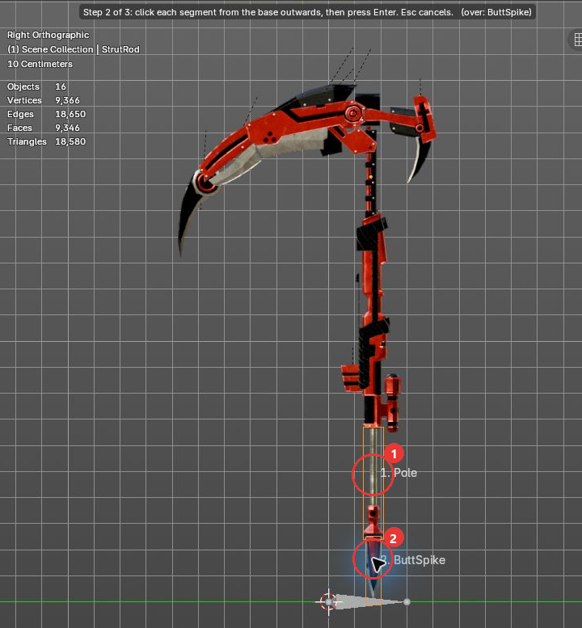{style="max-width:100%;max-height:155mm;width:auto;height:auto"}

*1：base は Pole。2：segment は ButtSpike。Enter、Z、Enter。*

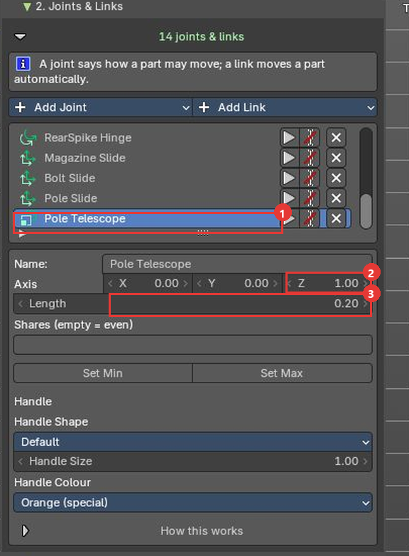{style="max-width:100%;max-height:155mm;width:auto;height:auto"}

*1：Pole Telescope。2：Z 軸を確認。3：Length 0.2、試して 0。*

## G. シーケンス

### 手順 23 — Add Sequence

**3. Sequences** で **Add Sequence**、名前をダブルクリックして `Scythe to Rifle`、Enter。

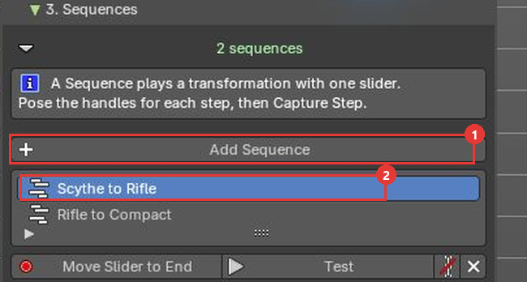{style="max-width:100%;max-height:155mm;width:auto;height:auto"}

*1：Add Sequence。2：名前をダブルクリックし Scythe to Rifle、Enter。*

### 手順 24 — 動作グループの記録

**Move Slider to End** で `100%`、ボタンが Record Step 1 になります。**4. Controls** で `BladeTip Hinge` 70、`Blade2 Hinge` 120 として Record Step 1。動かしたハンドルごとに目標 1 件、計 2 件が保存され、両関節スライダーは 0 に戻ります。

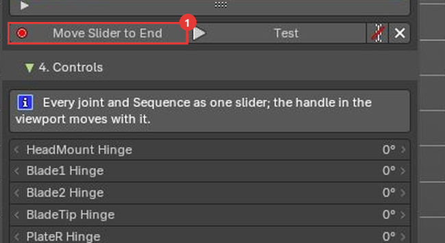{style="max-width:100%;max-height:155mm;width:auto;height:auto"}

*1：Move Slider to End を一度押すと Record Step 1 に。*

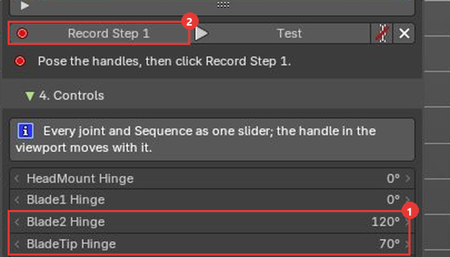{style="max-width:100%;max-height:155mm;width:auto;height:auto"}

*1：Blade2 120、BladeTip 70。2：Record Step 1、2 目標を保存し 0 へ。*

*残りのグループ：* 記録後も待機中です。次を動かし表示中の Record Step を押します。再度待機操作は不要です。

| 動作組 | 目標 | 記録ボタン |
|---|---|---|
| 2 | `Blade1 Hinge` 10 + `PlateL Hinge` 30 | Record Step 3 |
| 3 | `HeadMount Hinge` 90 | Record Step 5 |
| 4 | `Pole Slide` 0.6 | Record Step 6 |

番号は保存済み目標数 +1 で、クリック回数ではありません。2 ハンドルなら 2 増えます。4 グループで 6 目標です。対象を変えた場合は表示番号に従います。

### 手順 25 — 各ステップの設定

目標ごとに **Target**、イーズ、**Start**、**End** があります。同グループに同じ範囲を設定。刃 0…0.25、板と最初の刃 0.25…0.5、頭 0.5…0.8、柄 0.8…1。範囲の前は初期値、後は終値を保持します。Start/End は 0–1、Controls は 0–100% 表示です。

各項目は `Ease In Out`。次に `Rifle to Compact` を作り、`Grip Hinge` 90 と `RearSpike Hinge` 90（両方 0…0.5）、次に `Magazine Slide` 0.04 と `Bolt Slide` 0.06（両方 0.5…1）を記録。2 組目は Record Step 3 になります。各シーケンス完成後、記録バナーの **Cancel** で終了。項目は保持しスライダーは 0 へ戻ります。待機中の重複警告は次の記録候補を指すので、空のグループを追加しません。

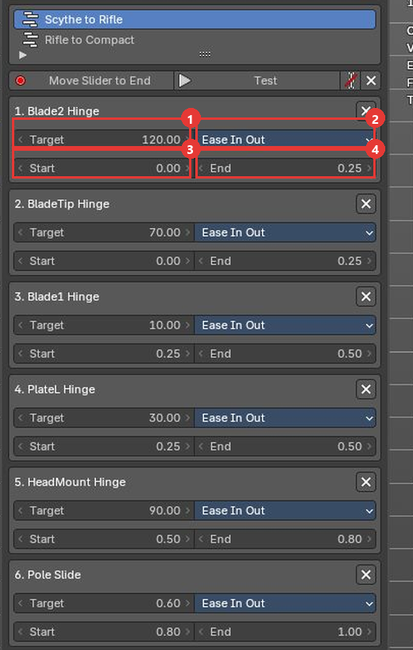{style="max-width:100%;max-height:155mm;width:auto;height:auto"}

*1：Target は関節目標値。2：Ease In Out。3：Start。4：End。6 項目すべて設定。*

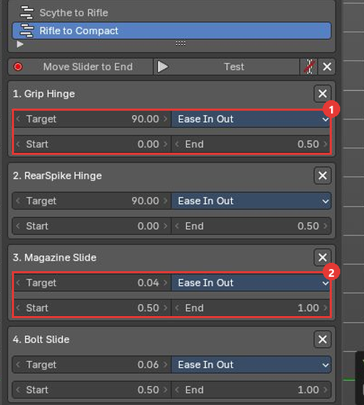{style="max-width:100%;max-height:155mm;width:auto;height:auto"}

*1：Grip/RearSpike は Target 90、Start 0、End 0.5。2：Magazine/Bolt は 0.04/0.06、Start 0.5、End 1。Ease In Out。*

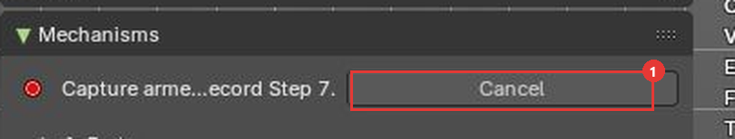{style="max-width:100%;max-height:135mm;width:auto;height:auto"}

*1：完成後バナーの Cancel。記録を終え、項目を保ち、シーケンスを 0 へ。*

### 手順 26 — シーケンスをテスト

記録ボタン横の **Test** で 0% →100% →0%、その後テスト前の値に戻ります。Scythe から `Scythe to Rifle`、最初が 100% の状態で `Rifle to Compact` をテスト。終了後両方 0%。

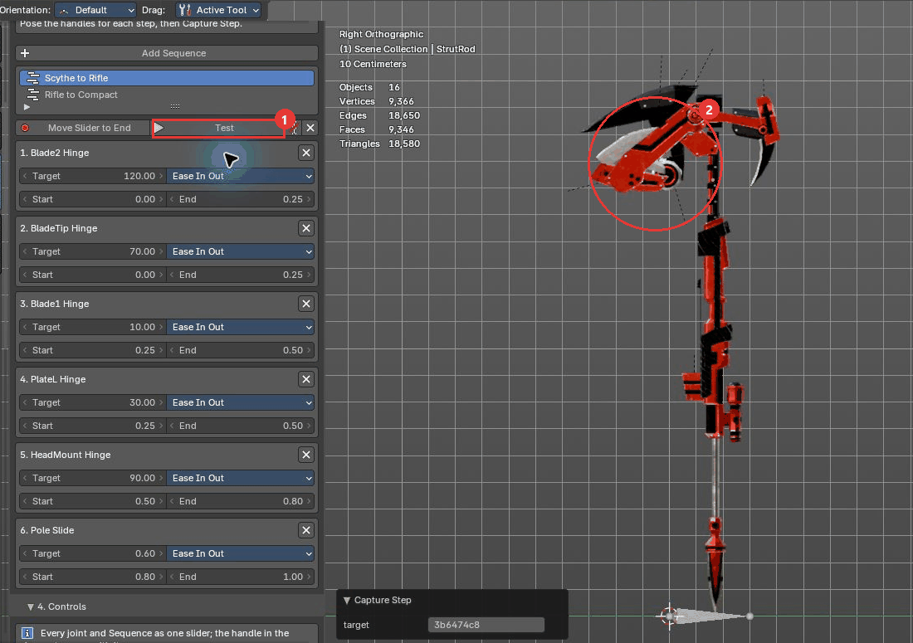{style="max-width:100%;max-height:155mm;width:auto;height:auto"}

*1：記録横の Test。2：折り畳みと復帰を確認。Compact テスト時は最初のシーケンス 100%。*

**確認：** 刃が曲がり、板が閉じ、頭が本体に沿い下がり、柄が縮み、すべて戻ります。

## H. 形態

### 手順 27 — Save Form

**4. Controls** の全スライダー 0 で **Save Form**、新項目をダブルクリックし `Scythe`。`Scythe to Rifle` を `100%` にして `Rifle` を保存、`Rifle to Compact` も `100%` にして `Compact` を保存します。個別関節はすべて 0、動きはシーケンスが供給します。選択中のシーケンスを終端にすると記録待機に戻ることがありますが Form 保存はステップ記録ではありません。`Scythe` の **Go to Form** で両方 0、待機解除。Rifle/Compact では選択中が 100% なので再待機する場合があり、追加目標が不要なら Record Step を押しません。

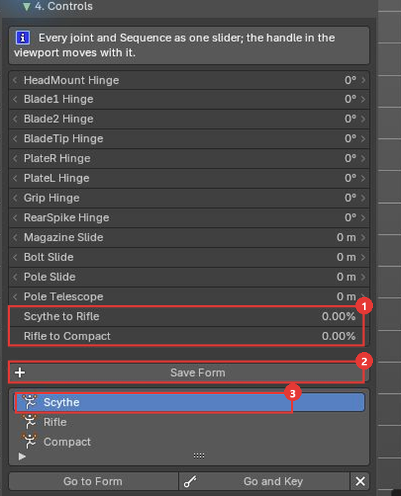{style="max-width:100%;max-height:155mm;width:auto;height:auto"}

*1：全シーケンスと関節を 0。2：Save Form。3：ダブルクリックして Scythe に改名、Rifle と Compact も同様。*

### 手順 28 — Go to Form

リストで形態を選び **Go to Form**。**Go and Key** はさらに現フレームで全コントロールにキーを打ち、変形アニメーションに使います。

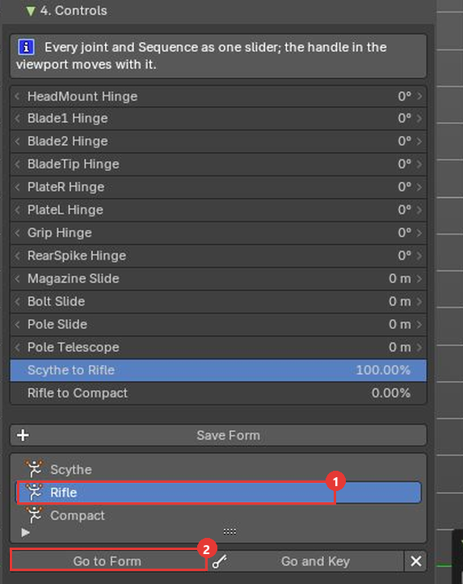{style="max-width:100%;max-height:155mm;width:auto;height:auto"}

*1：保存形態を選択。2：Go to Form。Go and Key はキーも挿入。*

### 手順 29 — ライフル形態

{style="max-width:100%;max-height:155mm;width:auto;height:auto"}

*1：Rifle。2：Go to Form。3：図のポーズと割合を照合。*

### 手順 30 — 収納形態

{style="max-width:100%;max-height:155mm;width:auto;height:auto"}

*1：Compact。2：Go to Form。3：図のポーズと割合を照合。*

`Scythe` に戻して保存します。

## 作成したもの

| 項目 | ボーン | 機能 |
|---|---|---|
| 15 部品 | `MCH-<part>`、`DEF-<part>` | 各メッシュは DEF ボーンの子 |
| Hinge 8、Slide 3、Telescope 1 | `CTRL-<part>` | 4. Controls のハンドル |
| Piston 1 | `MCH-<part>-aim`、`MCH-<part>-target` | 支柱が互いを向く |
| Follow 1 | なし | PlateR が PlateL に追従 |
| Sequence 2 | `CTRL-SEQ-<name>` | 各1スライダー |
| Form 3 | なし | スライダー値を保存 |

更新例は Rig Validator で問題報告なし。Auto Run Python Scripts をオフにした再読込でも、全個別コントロールと 3 形態の確認に合格しました。

## 次に試すこと

- `PlateR Follow` の **Curve** を有効にし Graph Editor で対応曲線を編集。
- 刃を畳み頭を上げた第 4 形態 `Carry` を保存。
- **Go and Key** で時間に沿って形態を記録し `DEF-` ボーンを出力（[VRChat ツール](08-vrchat.md)）。

## ギアリンク

Crescent Rose に歯車対はないため Gear Link は使いません。歯数比で Hinge 同士を連動し、クランクと車輪や回転を直進へ変えるラックに利用します。[ギアリンク](07-mechanisms.md#gear-linkギアリンク) を参照。

## クレジット

Crescent Rose モデル：amandangm、https://sketchfab.com/3d-models/crescent-rose-dcb6bfbb3b824c01a182fa131fe35824 、CC BY 4.0。本教程用に分割、拡大、リギングしました。Crescent Rose のデザインは Rooster Teeth Productions に帰属し、本アセットはファン制作の教材です。

[← 目次](index.md)
