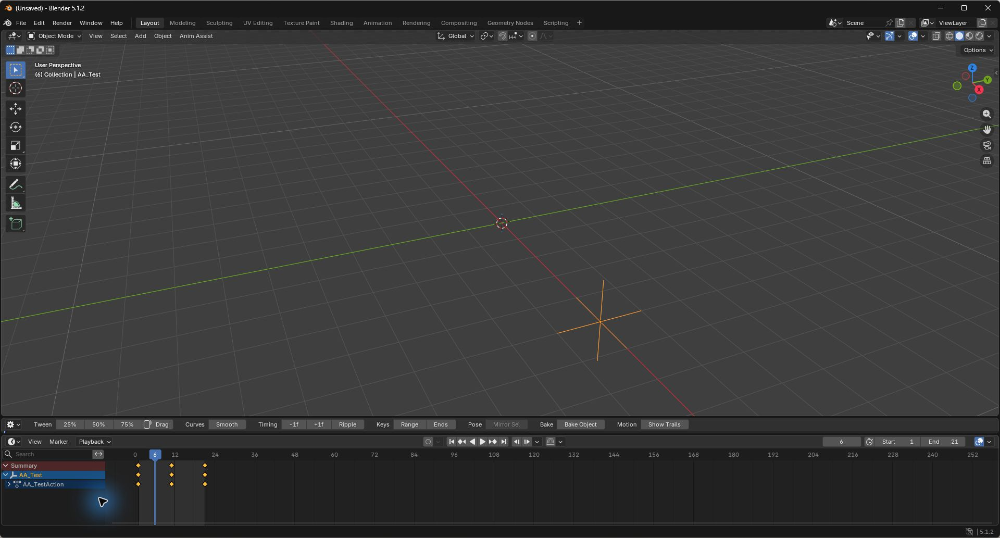
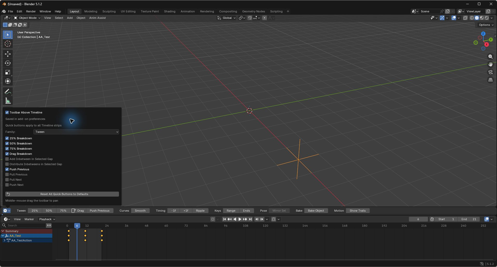
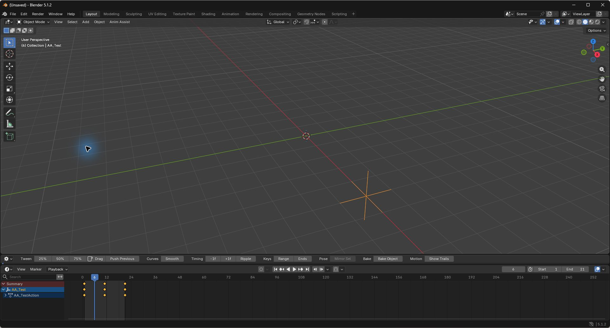
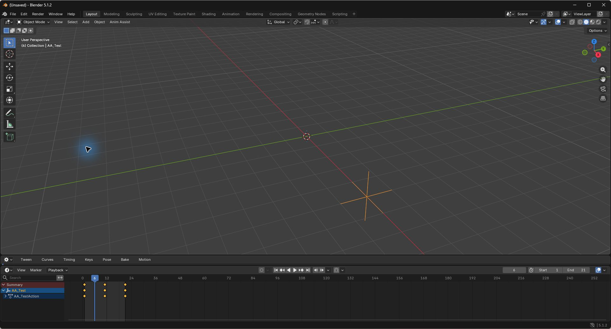
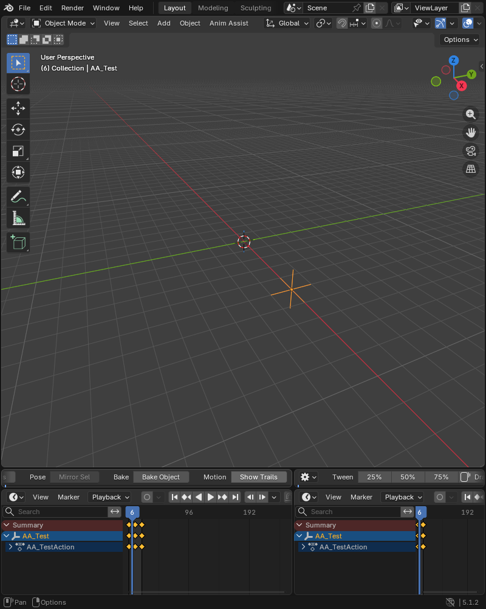

# Use the inline Timeline toolbar

Actual 12.5.0 ZIP runtime screenshots in **Blender 5.1.2 stand-in**. Actual Bforartists acceptance is pending. This candidate has known Redo and trail-sampling findings; see [qualification](qualification.md).

## 1. Click a quick tool beside its family

Select animated data. Use 25%, 50%, 75% or Drag beside Tween; Smooth beside Curves; -1f, +1f or Ripple beside Timing. Each visible quick button invokes its existing tool directly. A gray button needs its animation prerequisites; hover for its reason. Family menus retain every command.

### Breakdown anchors

At an empty playhead frame, 50% blends between surrounding keys: values 0 and 10 produce 5. If a key already exists at the playhead, that key becomes the previous anchor. A current value 5 and next anchor 10 produce 7.5 after 50%. Repeating the command can therefore move an existing key again. Hover the button for the full mask/scope and anchor explanation.

## 2. Choose your quick buttons

Open Gear at the left end, choose a family, then check the tools you use. This screenshot checks Push Previous in Tween. Configuration changes preferences and leaves animation untouched.

Close the popup. Push Previous now sits beside Tween, ready for one-click use.

For Pose, choose that family and check Swap; uncheck Mirror Selected if you want to replace its quick copy. The command requires an appropriate rig/pose selection.

## 3. Remove pins or reset

Uncheck a tool to remove its quick copy. Its menu entry stays available. Unchecking every tool leaves all seven family menus. Reset All Quick Buttons to Defaults restores the 13 defaults across every family.

The same selections appear in all Timeline strips. Add-on Preferences has the same checkbox controls. Save Preferences normally to retain choices after restart; Gear offers a Save Preferences button when automatic saving is off.

## 4. Pan a narrow row

Middle-mouse drag left over the toolbar to reach later families; drag right to return to Gear. Selected tools keep their positions and remain in the row. This narrow left Timeline is panned to Pose, Bake and Motion; the adjacent Timeline shows the shared choices from its own initial pan position.

The native playback and keyframe header sits directly below each strip. Hover the animation tool for context, availability and existing operation help. Long labels and many chosen tools increase the distance you need to pan.

## Acceptance

Follow [the owner checklist](UAT.md) in your Bforartists workspace. Known recovery and sampling findings must be resolved before the candidate is declared fully qualified. No owner installation or public publication was performed during this implementation.
