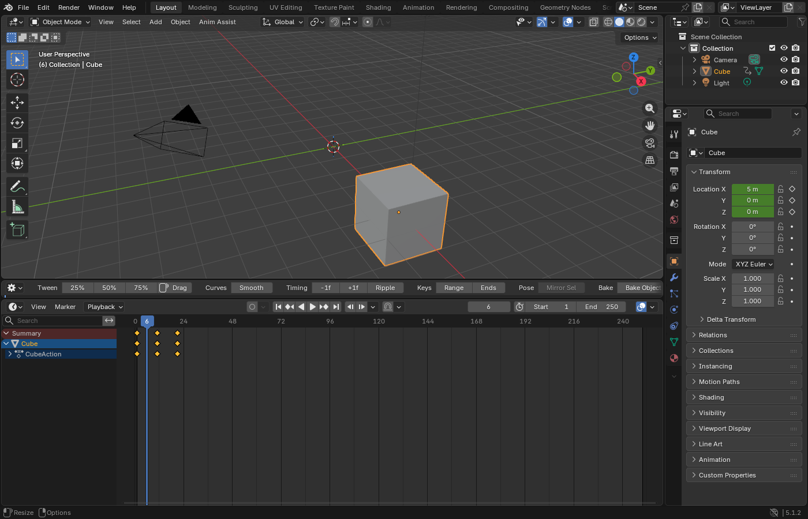

# Anim Assist 12.5.1 — Timeline layout repair

This patch repairs the oversized gray toolbar editor and collapsed Timeline reported in 12.5.0.

Published to the repository on 2026-10-12 in commit `d065fdc`. The current download and all four add-on version fields identify **12.5.1**. The public ZIP was verified against the recorded checksum; see [package-receipt.json](package-receipt.json).

## What changed

- After a resize, the toolbar automatically rejoins its adjacent Timeline and recreates a thin row. Added height goes to the native key area. Recovery occurs after the resize and timer update; the editor can briefly expand during the drag.
- Creating a second row reserves space for the native frame ruler and editable keys. A short Timeline keeps its native header and shortcuts until you enlarge it.
- The split always creates the toolbar above the original Timeline. An adjacent inverted pair from an older layout is recognized for repair.
- A transient screen-operation failure is retried after a resize or five seconds, instead of blocking that Timeline for the whole session.
- The preference tooltip explains the minimum-space behavior.

The seven families, 70 presets, 13 default buttons, quick selections and animation operators are unchanged. All version fields identify 12.5.1. The README lists only the latest Anim Assist download.

## Install and recover

Install `b4_anim_assist_v12.5.1.zip` through **Preferences > Add-ons > Install from Disk**, then restart Bforartists. Keep **Toolbar Above Timeline** enabled. Enlarge the Timeline using the border above the whole toolbar/Timeline pair. If the pair is too short, the second row waits until there is room.

To return to one native Timeline, turn off **Toolbar Above Timeline**. The paired editors rejoin. A manually rearranged editor that is no longer next to a Timeline is not joined to unrelated editors.

## Evidence and limits

Actual mouse drags, collapsed-key-area recovery, a short Timeline, re-expansion, preference toggling and 150% UI scale were checked in a normal Blender 5.1.2 GUI stand-in without event simulation. A fresh session from the final ZIP also repaired an inverted pair and retained one toolbar after saving and reopening its fixture. Every staged Python file matches this ZIP. See [qualification](qualification.md) and [layout evidence](layout-evidence.json).

Actual Bforartists and the owner's saved workspace remain unverified on this host. Fullscreen and multiple-window behavior have not been exercised for this patch. The earlier native B50 Redo and trail-position findings remain open; see the [previous qualification](../12.5.0/qualification.md). No GitHub Release has been created for this patch.

