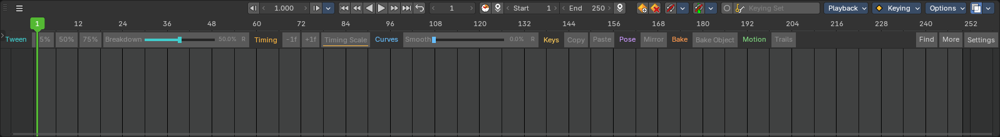
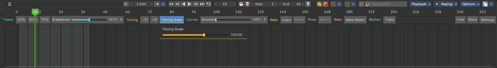
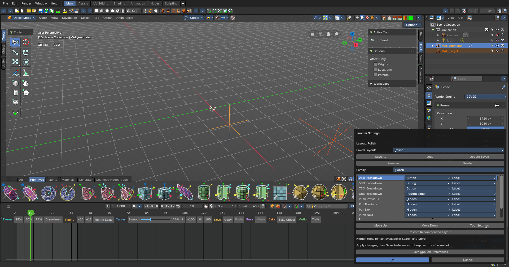
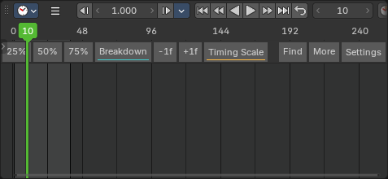

# Anim Assist 12.6.2 qualification

Local technical qualification; **owner usability and publication pending**.
This add-on runs in stock Bforartists. It is not a custom application build.

## Artifact and host

- ZIP: `b4_anim_assist_v12.6.2.zip`, 599,156 bytes, 208 files, 206 Python files.
- SHA256: `5492e94a773a0398e281d0b3a0410de0b75c9e92fd5f4b4980373e39474643f7`.
- Four version fields agree; strict inventory and all Python syntax checks pass.
  Original 89 catalogue mappings are retained. No EXE or DLL is packaged.
- Native host: Bforartists 5.2.0, Blender runtime 5.3 Alpha, build `0a1ca45552db`.
- Every installation was extracted from that ZIP into an asserted task-owned
  profile and compared byte-for-byte. Owner scenes/preferences were not opened.
  Recovery saves stayed in isolated TMP for final runs; early intermediate runs
  used the host's ordinary shared-temp recovery location.

## Measured results

| Check | Result / evidence |
| --- | --- |
| Existing immediate effects | 80 pass: selection, clipboard, pose, curve, bake and world-space trail assertions |
| Existing interactive tools | Nine × preview/commit/cancel: 18 cases pass |
| Native immediate row access | 21 button cases across original and Recommended configurations pass |
| New native row sliders | Eight × Inline/Popout × commit/cancel: 32 cases pass |
| Undo/redo | 56 native recovery assertions pass in the full regression; six more in the default-row pass |
| Settings | Actual dialogs open; accepted changes persist; Cancel preserves animation and preferences |
| Extended input | Smooth −100% and 200% match expected values and recover through undo/redo |
| Layout library | Named save, load, Unicode rename, delete, reset, settings transfer and rejected future schema pass |
| Normal restart | Exact active record/library and automatic add-on enable restored |
| Slider edges | Actual preset/reset pointer routes, Shift precision, Ctrl snapping, right-click cancellation; seven neutral scalar settings and locked/hidden scope pass |
| Native workspace | Manual 85px height retained, top/bottom header, maximize/restore, effective 1.5×/2× scale, pan, wheel zoom, playback and two-window rows pass |
| Narrow width | Actual 477px and 1117px split Timelines retain bounded controls, utilities and saved configuration |
| Lifecycle | Disable/re-enable clears/recreates exactly 13 native bindings; active disable restores animation and removes timer; workspace loss cancels; saved scene reload preserves animation/layout/options |
| Pure checks | 12 model, six transaction and five geometry tests pass |

Raw evidence: [full regression](../../plans/2026-10-14-configurable-slider-toolbar/evidence/qualified-full/full-coverage.json),
[default-row/settings](../../plans/2026-10-14-configurable-slider-toolbar/evidence/qualified-ui/ui-coverage.json),
[layouts/restart](../../plans/2026-10-14-configurable-slider-toolbar/evidence/qualified-layouts/layout-coverage.json),
[lifecycle tail](../../plans/2026-10-14-configurable-slider-toolbar/evidence/stress-tail/stress.json),
[presets/scope/narrow width](../../plans/2026-10-14-configurable-slider-toolbar/evidence/edges-final/stress.json).
The reached cells of the earlier `stress-complete` run corroborate scale,
header, navigation, multiwindow and manual-height assertions. Its aggregate is
false because the harness attempted a native resize while a BLOCKING modal made
area_move unavailable. The revised tail tests actual workspace loss instead;
it does not relabel the failed diagnostic as a full pass.

## Screenshots

## Limits and remaining checkpoint

This is a supported pixel band in the Timeline WINDOW, not a second HEADER.
A completely collapsed canvas cannot display it. One initial expansion attempt
is retained; no persistent sizing repair runs. Native top-header layouts preserve
the frame ruler above the band. Narrow widths use overflow.

The fixtures are synthetic animations in a real host. Production rigs, alternate
themes/platforms, mixed-monitor DPI, keyboard-only accessibility, and installation
under a renamed extension repository are not verified. Package-aware preference
lookup is implemented, but source inspection is not a native extension test.
Live border resizing while a blocking drag is active was unavailable in this
host; ordinary resizing and workspace-loss cancellation were measured separately.
Icon mode uses generic glyphs for some actions, not a complete AnimBot icon set.

All eight numeric controls use existing Anim Assist algorithms. This is not full
AnimBot feature parity. Still screenshots cannot prove absence of flashing in
the owner's workspace. Complete the [owner checklist](../../plans/2026-10-14-configurable-slider-toolbar/02-UAT.md)
before claiming owner acceptance. The author also wrote the tests; see the
[gate audit](../../plans/2026-10-14-configurable-slider-toolbar/GATE-AUDIT.md).

No push, main merge or GitHub release publication occurred.
