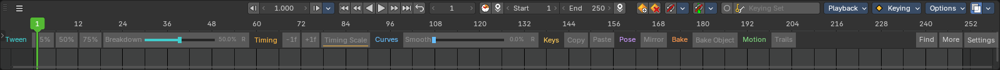
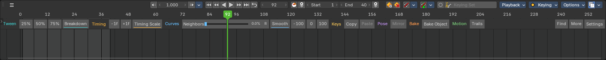

# Anim Assist 12.7.0 qualification

**Delegated workspace workflow: Pass. Local add-on release; not published.**
The user requested Codex perform the usability checkpoint and commit a new
overhaul version after success. Personal aesthetic preference is not treated
as an outstanding authorization gate for this delegated check.

## Exact artifact

`b4_anim_assist_v12.7.0.zip`: 599,297 bytes, 208 files, 206 Python files.
SHA256: `47d25fe0568e7685ca46c58fe7cc5310bd34411f76debaf1839d312d61828027`.
Four version fields agree; strict inventory and syntax pass; no EXE or DLL.
Only CHANGELOG, __init__, constants and manifest bytes differ from 12.6.2.
The 89 action mappings, numeric algorithms, UI and lifecycle code are unchanged.

Native host: stock Bforartists 5.2.0, Blender runtime 5.3 Alpha,
build `0a1ca45552db`. Every installed byte was compared with the ZIP in an
isolated profile. Owner scenes and preferences were not opened or changed.

## Workflow

[Native workflow evidence](../../plans/2026-10-14-workspace-qualification/evidence/overhaul/workflow.json)
records 53 setup/action/assertion steps. Fresh startup allocates a 112px
Timeline and shows the complete row without a manual reveal or artificial
expansion. Breakdown drag/release, one native undo/redo, Smooth settings and
Popout cancellation, per-family reorder/configuration, Blocking/Polish names,
unsaved-change guard, explicit discard/load, Timing Scale right-click cancel,
native scrub/play, idle shrink/expand, preference restart and saved generated
workspace reload pass.

The [review](../../plans/2026-10-14-workspace-qualification/REVIEW.md) records the
visual judgement and Bforartists UI skill audit. It is an author review using
synthetic animation and native UI events, not an independent blind user study.
Standard native dialog RNA supplies setting/name input; accept/cancel and row
gestures use native events. No owner workspace file was provided.

## Functional regression

[Exact-ZIP full regression](../../plans/2026-10-14-workspace-qualification/evidence/regression/full-coverage.json):
80 immediate tool effects, 18 original interactive cases, 21 native row button
cases, 32 new slider cases (eight × Inline/Popout × commit/cancel), 56 native
undo/redo assertions and nine settings/misuse/lifecycle extras pass.
Pure checks: 12 configuration, six transaction and five geometry tests pass.

The earlier 12.6.2 [qualification](../12.6.2/qualification.md) additionally
records the unchanged implementation's multiwindow, scale, narrow-width,
preset/reset, neutral/scope and timer-cleanup evidence. Those results remain
labelled by their original package; they are not counted as new 12.7.0 runs.

## Actual screenshots

## Limits

The supported canvas band is not a new native HEADER. A fully collapsed
Timeline needs expansion; the first sizing attempt runs once and manual
resizing is respected. At the initial 112px size the keyframe canvas is small.
Some icon modes use generic glyphs; R is a compact reset label. Width overflow
uses More and does not rewrite saved modes.

Personal workspaces, production rigs, other platforms/themes, mixed-monitor DPI,
renamed extension installations and keyboard-only interaction remain unverified.
Stills/stable geometry do not prove absence of all transient flicker on other
hosts. This release exposes existing Anim Assist tools rather than full AnimBot
algorithm parity. Publication requires a separate Confirm merge update reply.
