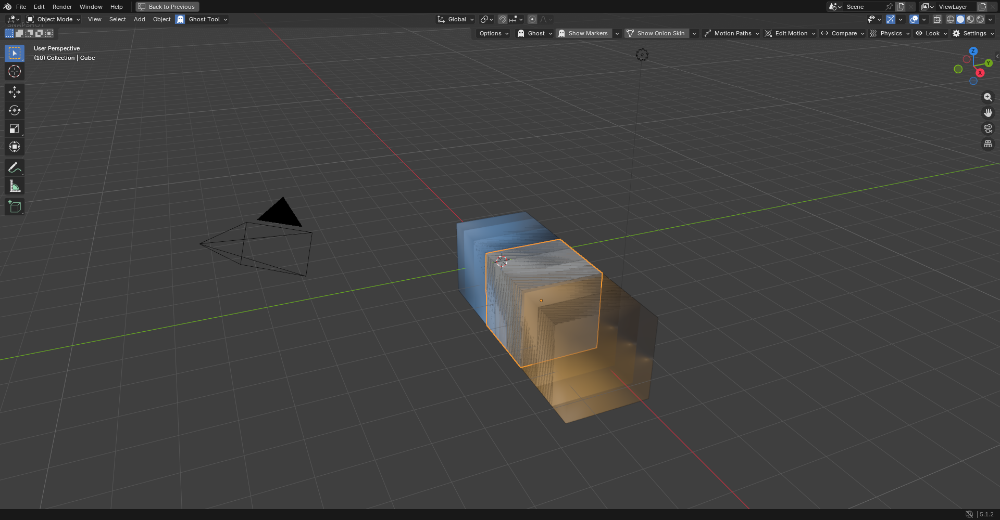
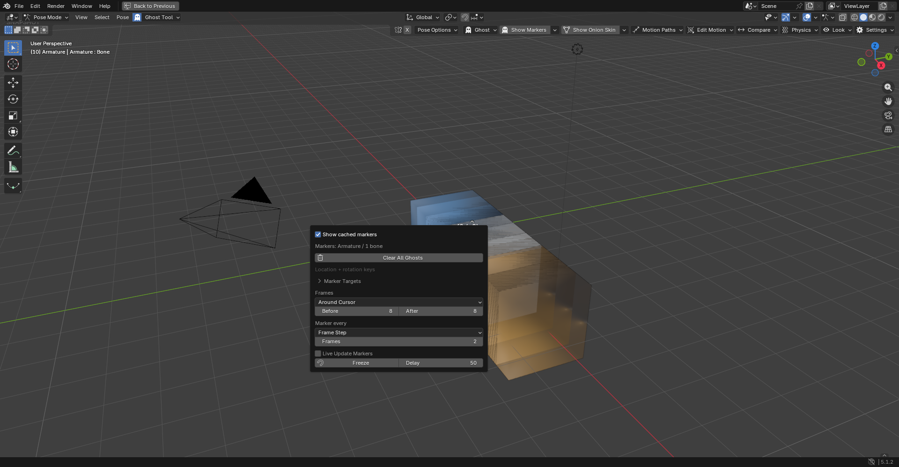
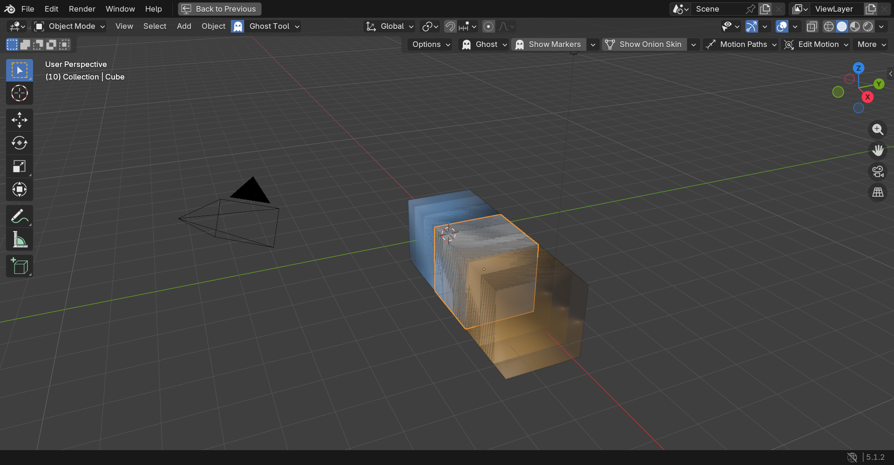
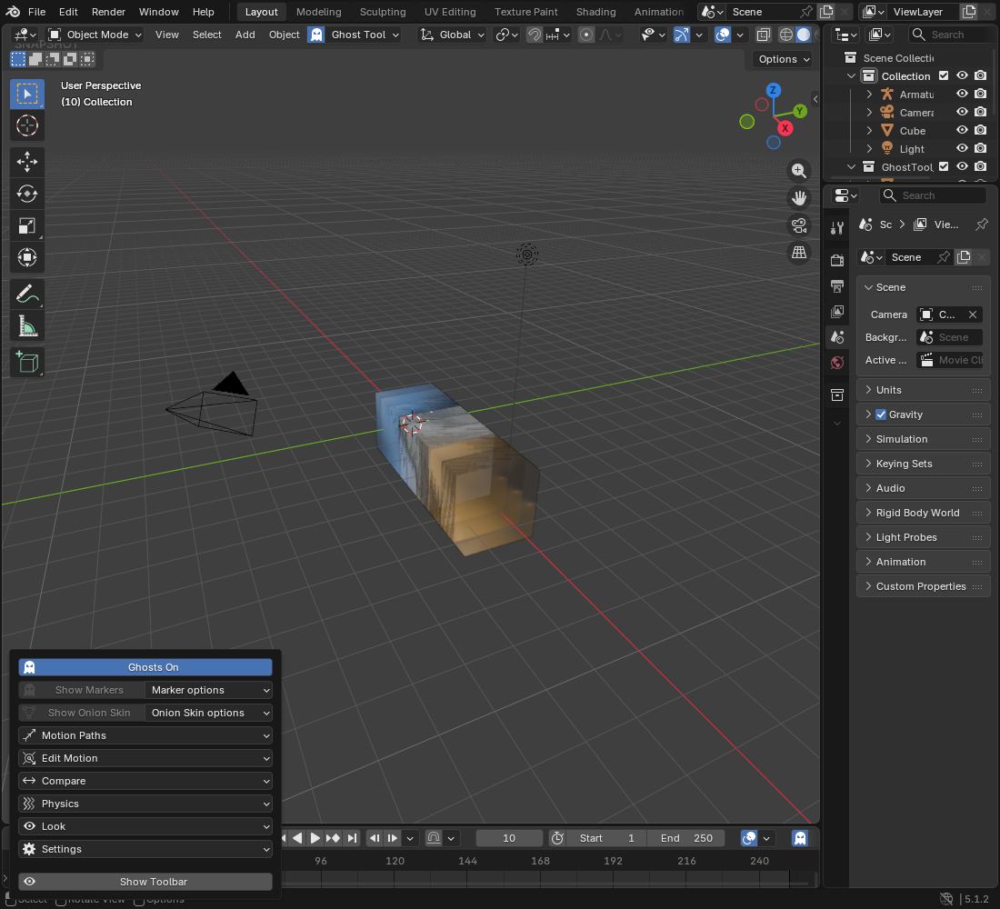

# Ghost toolbar verification

Historical verification of the initial 4.2.5 source candidate. The current source candidate is **4.2.10** (unpublished); see its [verification status](../releases/4.2.10/verification-status.json) for the current native startup blocker. The original evidence below retains its tested version and checksum.

Verified on 2026-10-12 against an isolated candidate built from the source. **178 checks/cases passed:** 117 background assertions, 56 native toolbar checks and five native auto-key transform cases. Independent task and final integration reviews approved the change. Source remains **4.2.5**; no release or repository push was performed.

## Host and evidence limits

The available host was **Blender 5.1.2**, with only the add-on's Bforartists registration gate patched for testing. Each process used factory startup and disposable scripts/configuration. The configured Bforartists executable was unavailable. **Native Bforartists geometry, Tool Shelf integration, full keyboard navigation, theme variants and production rigs are NOT VERIFIED.** Engine images below show stock Blender, not Bforartists. This toolbar update does not claim a new backend jitter fix.

The [machine-readable receipt](verification.json) records a fresh full run against the final candidate. An earlier GUI harness failed because maximizing the viewport replaces its Area RNA; reacquiring the area fixed the harness. Native evidence files are now cleared before launch to prevent stale PASS results. The final source correction names the existing marker-and-skin clear action **Clear All Ghosts** and describes both consequences; the full verification was repeated after that correction.

The candidate contains 29 parsed Python modules. ZIP integrity passed and every extracted module matched the working source bytes. The released `releases/b4_ghost_tool_v4.2.5.zip` remains unchanged, SHA256 `5cfb8cee78051dc2242b68dd14f88ec17fad7a6ffdf058b6cea3deaed0db05d5`. The candidate is local under ignored `build/ghost-toolbar/` and is not a published download.

## Behavior checked

| Evidence | Result |
|---|---|
| Display location, 17 checks | Four choices, retained HEADER default, multiple ordinary viewport recovery, excluded legacy windows, native region choice preserved, reload cleanup |
| Toolbar UI, 7 checks | Shared destinations, fixed command order, target-independent options, disabled generation, independent folds, width/scale hysteresis, draw without frame sampling or new jobs |
| Cached display, 8 checks | Display-only flags preserve marker and skin identity, hidden picking disabled, skin visibility isolated per scene, generation restores visibility |
| Existing UI and authoring suites, 85 checks | Marker/compare targets, afterimage/header/council UI, authoring pause and snapshot target regressions |
| Native toolbar, 56 checks | Four actual layouts, Object/Pose captures, options opening, missing selection, cache-preserving hide/show, native-region recovery, callback teardown/reload |
| Native authoring, 5 cases | Real translate operator with auto-key: Object and Pose with live updates off/on, plus cancellation. No sampling during held gestures; one refresh after settlement |

Actual native header widths: **1920 px at scale 1.0 → FULL**, **1393 px at 1.0 → COMPACT**, **900 px at 1.0 → MINIMAL**, **1920 px at 1.5 → COMPACT**. Conservative bands use total header width normalized by UI scale because the append API does not expose preceding controls' occupied width. Native horizontal panning remains the fallback for unusually crowded headers. No resize timer was added.

## Native images

Real engine captures were inspected for visible labels, single options arrows, retained native controls, overflow and recovery. Captures verify appearance and the scripted checks above; they do not prove clicking every feature or keyboard focus restoration.









## B4Artists rule audit

Pointers below are relative to the repository root. PASS applies to this change's scope; retained conventions and unavailable host checks are explicit.

| Rule | Status and evidence |
|---|---|
| R1 act-first | DEVIATION: generate actions run immediately, but existing scene-based sampling settings remain. Approved scope reuses drawers instead of converting unrelated operators to redo properties. `ghost_tool/ui_panel.py`, `tests/test_ghost_toolbar_ui.py` |
| R2 no-pre-dialog | PASS: toolbar show/hide runs directly; generation adds no confirmation dialog. `ghost_tool/ui_panel.py`, `tests/test_ghost_toolbar_native.py` |
| R3 menu-reachable | PASS: full Ghost command map retains all eight features and hide/show; named Restore remains inside Compare. `tests/test_ghost_toolbar_ui.py` |
| R4 standard-places | Existing Object/Pose Tool Shelf copies preserved; actual Bforartists shelf behavior NOT VERIFIED. `ghost_tool/ui_panel.py` |
| R5 tools-apart | PASS: generation buttons and adjacent named options are separate; each feature reuses its authoritative drawer. `tests/test_ghost_toolbar_ui.py` |
| R6 setting-not-button | PASS for new cached visibility checkboxes. Existing feature toggle conventions retained as a DEVIATION. `ghost_tool/ui_panel.py`, `images/marker-options.png` |
| R7 no-header-icons | PASS for new native popover panels. Existing full-home section header icons retained as a DEVIATION to avoid unrelated restructuring. `ghost_tool/ui_panel.py` |
| R8 actions-then-options | DEVIATION: approved options-only destinations place cached visibility first, then feature settings and target folds. Existing mixed drawers retained. `images/marker-options.png` |
| R9 one-home | PASS: one chosen display location; allowed toolbar/menu copies share drawers. `tests/test_ghost_display_location.py` |
| R10 show-dont-hide | PASS: missing targets disable generation while options and full menu remain accessible; specific operator poll messages retained. `tests/test_ghost_toolbar_ui.py`, `images/narrow-recovery.png` |
| R11 explains-itself | PASS for new properties, truthful generation descriptions and hidden/skip-save show/hide parameter. English strings follow the add-on's existing convention. `ghost_tool/ghost_data.py`, `ghost_tool/preferences.py`, `ghost_tool/modal_operator.py`, `ghost_tool/mesh_ghosts.py`, `ghost_tool/ui_panel.py` |
| R12 readable-at-width | PASS in captured Blender layouts and existing target-list suites; exact Bforartists 132/220 px and font metrics NOT VERIFIED. `images/high-scale-toolbar.png`, `tests/test_ghost_marker_targets_ui.py`, `tests/test_ghost_compare_targets_ui.py` |
| R13 no-dead-controls | PASS: cached flags consumed by rendering/picking; saved preferences consumed by native drawing/recovery. `tests/test_ghost_cached_display.py`, `tests/test_ghost_display_location.py` |
| R14 evolve | PASS: live defaults, backend authoring pause, old location identifiers and release archive preserved. `tests/test_ghost_authoring.py`, `verification.json` |

Placement inventory: top-tier repeated actions are Show Markers, Show Onion Skin and toolbar visibility; mid-tier destinations are the eight feature popovers. The toolbar callback, Ghost/More maps and cached visibility checkboxes are net new to provide persistent access and preserve previews. Existing generation, feature controls and target folds are reused. No viewport gesture tool was added. Legacy window-launch controls remain absent.

The owner-approved design intentionally preserves R1/R6/R7/R8 conventions above. Operator undo/redo misuse after every feature, Escape focus restoration and a full Bforartists session remain NOT VERIFIED; no execution refactor of those feature operators is claimed.

## Fable design and execution review

The approved design was checked against its interaction contract: persistent access, reversible hide/show, missing-target access, stable feature order, truthful cached display, narrow/high-scale layouts and inherited native styling. No custom color/font overrides, invented readiness badge or progress state were added. Visual inspection found duplicate options arrows; these were removed and the native evidence rerun.

The canonical coding router selected T3 Prime/OMP but could not host its Unix-socket inference relay in this Windows process. Its receipt explicitly authorized native continuation. Independent implementation/spec/quality reviews and final integration review passed. The separate adaptive review remained advisory INCONCLUSIVE (host evidence not consumed), with no reviewer invoked; it is not counted as a passed review.

## Reproduce

From the repository root, using PowerShell on a machine with the runner's configured Blender installation:

```powershell
python docs/ghost_tool/toolbar/verify.py
```

The runner builds an isolated local candidate, runs all suites and records logs/images under ignored `build/ghost-toolbar/`. `--native-only` repeats native checks without claiming a new background run. See [design](design.md) and [guide](README.md).
